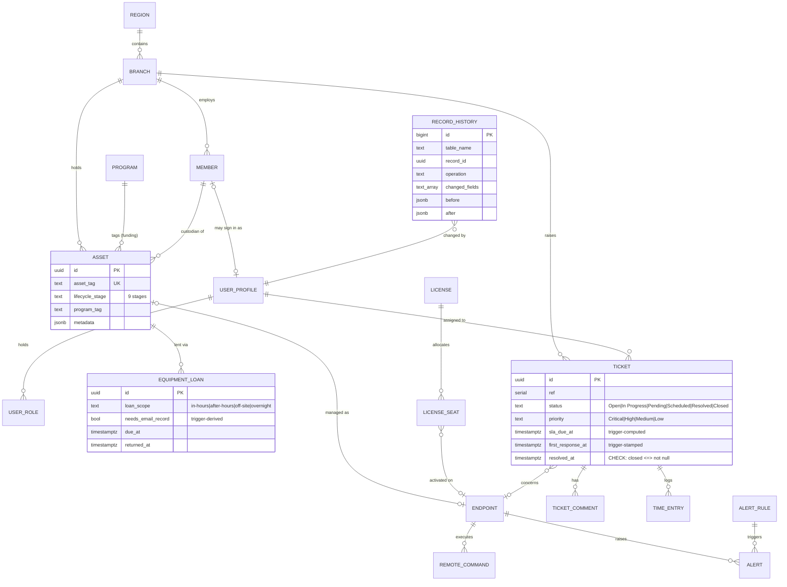
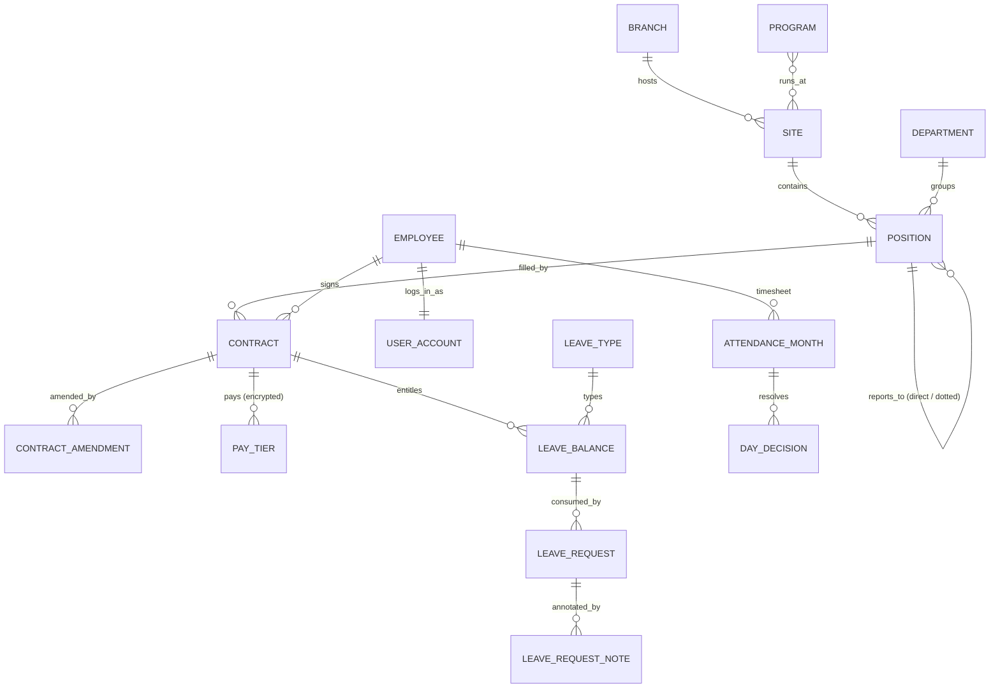
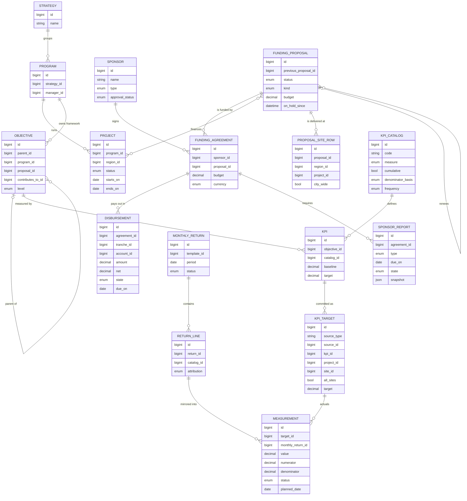

# Youssef Operations Kit — Complete AI Agent Master Handoff Specification

> **Repository:** `https://github.com/youss8/youssef-operations-kit` (MIT License)
> **Owner:** Youssef Kharbout · `youssefkharbout3@gmail.com` · `github.com/youss8` · `linkedin.com/in/youssef-kharbout`
> **Purpose:** Single, 100% self-contained technical, content, UX, and data specification for building the open-source **Youssef Operations Kit**—an architectural engineering portfolio, interactive ATS/DACH print-ready CV, 3 deep-dive enterprise system case studies, 6 live client-side interactive sandboxes, a 10-pattern dual-stack enterprise UI component vault, an 11-item interactive AI engineering toolkit, 5 downloadable ops templates, and a 4-project R&D Lab.

---

## 0. Mandatory Agent Guardrails & Non-Negotiables

Before creating or editing a single file, the implementing AI agent **MUST** enforce all 7 rules:

1. **Strict Clean-Room Sanitization (Zero Proprietary Leakage):**
   - Never include real employer names, internal organizational URLs, real branch/city names from internal systems, real staff/donor/beneficiary names, `.env` secrets, credentials, API keys, or raw proprietary source code anywhere in the repository.
   - All case studies, ER diagrams, UI vault snippets, and live sandboxes **MUST** use generic enterprise SaaS terminology (`Organization`, `Workspace`, `Region`, `Branch`, `Operating Unit / Site`, `Sponsor / Funding Partner`, `Program`, `Member`) and 100% synthetic JSON data.
   - Run a repository-wide grep audit before final sign-off to guarantee zero sensitive or proprietary strings exist.

2. **100% Honest Ownership & Deployment Attribution (Interview-Proof):**
   - Never blur solo engineering and multi-developer team contributions. Every case study and CV entry **MUST** clearly separate **Full Platform / Team Context** from **Youssef's Direct Ownership**:
     - **System 01 (`SYS-01` — IT Operations & Asset Helpdesk):** **100% Solo End-to-End Architecture & Build** (1 developer — Youssef Kharbout). Engineered to production-grade specifications to consolidate ~900–1,000 hardware assets and licenses across ~150 staff (~15–20 monthly requests) and replace fragmented third-party apps; internal management did not roll it out into live internal adoption (so the endpoint telemetry agent and 11-tool MCP server were engineered and architecture-verified, not deployed across a live fleet). State this transparently as *"Production-Engineered Internal Platform (100% Solo End-to-End Architecture & Build)"*—never exaggerate fleet deployment.
     - **System 02 (`SYS-02` — HR Lifecycle Platform):** **3-Developer Team — Core Full-Stack Contributor & Co-Architect (Pre-RMS Core).** Youssef co-architected the core foundation and built core modules (org structure, employee profiles & journeys, contracts & amendments, leave pricing & approvals, attendance foundation) **prior to the Recruitment (RMS) module**. System 02's deep-dives and both live demos **MUST** exclusively showcase pre-RMS ownership (**Leave Pricing & Two-Tier Approval Desk** and **Attendance Month Timesheet + Contract `asSigned()` Diff**), referencing RMS strictly as a brief *Full Platform Team Context* note.
     - **System 03 (`SYS-03` — Multi-Entity Funding, Portfolio & KPI Analytics Platform):** **3-Developer Team — ~80% Primary Architect & Full-Stack Builder.** Youssef designed and built ~80% of all workflows, UI/UX patterns, KPI/funding architecture, and interactive features.

3. **Unmistakable Commercial Tech Career Positioning (NO NGO Roles):**
   - Honestly state Youssef's Nov 2024 – Dec 2026 employment context as an NGO Full-Stack Web Developer & IT Systems Specialist, while making the site headline, bio, availability badge, and CV summary unmistakable: **actively targeting Full-Stack Software Engineer roles at remote international tech startups, SaaS product companies, freelance engineering engagements, and tech relocation to Germany — explicitly NOT seeking NGO roles.**

4. **Anti-"Vibe Coder" Architectural Craft:**
   - **Strictly Banned:** Dark-mode-first purple/indigo neon gradients, glowing blurred orbs, floating decorative blobs, glassmorphism over busy backgrounds, generic centered `"Hi, I'm Youssef 👋"` hero clichés, typewriter animations, fake testimonials, circular skill-percentage meters, or unverified vanity stats.
   - **Strictly Required:** **Light Mode by default** (*Archival Stone & Deep Forest*), an engineered **Dark Mode toggle** (persisted in `localStorage` with zero FOUC), `1px` structural hairline borders instead of blurry drop shadows, Swiss-grid typographic discipline (`Plus Jakarta Sans` + `JetBrains Mono`), `font-variant-numeric: tabular-nums` on every number/KPI/table/timer, accessible **Icon + Label + Shape** status primitives (never color-only), and 6 genuinely working interactive engineering sandboxes.

5. **Zero Stubs or Lazy Placeholders:**
   - Every button, filter, tab, toggle, modal, drawer, copy control, `.md`/`.json` download, and reset control must execute real working logic. Never leave `// TODO`, empty handlers, truncated code snippets, or broken links.

6. **Drop-In Content Extensibility:**
   - All Case Studies, Vault Components, AI Gems/Skills/Workflows, and Ops Templates **MUST** live in Zod-validated **Astro Content Collections** (`src/content/*`) so Youssef can swap starter dummy AI prompts or templates with his personal assets in seconds by editing Markdown/JSON files—without touching UI code.

7. **Accessibility, Mobile Responsiveness & Print Precision:**
   - Support full keyboard navigation, `aria-pressed` / `aria-expanded` / `role="dialog"` semantics, zero horizontal overflow down to `375px` mobile width, live `LTR/RTL` testing inside the Component Vault, and clean 1–2 page `@media print` A4 PDF export on `/cv`.

---

## 1. Owner Profile, CV Rules & Single-Source Data (`src/data/profile.ts`)

Store all personal, career, education, certification, language, leadership, and stack metadata in `src/data/profile.ts` so both `/` (Workbench Home) and `/cv` (Interactive & Print PDF CV) stay permanently synchronized.

### 1.1 Locked-In Profile & CV Decisions
- **Target Roles:** Full-Stack Software Engineer, Product / Systems Engineer, AI-Native Full-Stack Developer.
- **Target Environments:** Remote international tech startups & SaaS companies, tech companies offering relocation to Germany, and freelance engineering/architecture projects. **Explicitly NO NGO roles.**
- **Availability Window:** Fixed-term contract wraps up December 31, 2026 → **Available January 2027**.
- **Public Contact Channels (Strict):** Email (`youssefkharbout3@gmail.com`), GitHub (`https://github.com/youss8`), LinkedIn (`https://www.linkedin.com/in/youssef-kharbout`), Open-Source Repo (`https://github.com/youss8/youssef-operations-kit`). Do **not** include WhatsApp, phone numbers, X/Twitter, or scheduling link placeholders.
- **Future Custom Domain Candidates (Document in `README.md`):** `youssefkharbout.dev`, `youss.dev`, `opskit.youss.dev`, `kharbout.dev` (domain not yet finalized; use relative paths and an env-driven `site` URL in `astro.config.mjs`).
- **Education Format (Strict):** Display **`B.Eng. in Informatics Engineering — University of Aleppo (5-Year Engineering Degree)`**. **Strictly omit the 72% GPA average** from both website and CV.
- **Employer Labeling:** Display cleanly as `"Multi-Branch Operations Organization (NGO)"` on the public website, paired with a client-side optional text input on `/cv` (hidden during print) allowing Youssef to substitute the exact legal employer name right before printing a private PDF.
- **CV Dual-Mode Toggle:**
  - `International / Remote Tech Mode` (Default): Text-only crisp header, zero photo (US/UK/global startup standard).
  - `DACH / Germany Mode`: Reveals a structured `96px × 116px` headshot portrait frame on the right edge of the header (displaying a clean geometric `YK` monogram placeholder until Youssef drops `/public/photo.jpg` into the repo) + explicit **Open to Relocation to Germany** and **German A1.2 → B1 (6–8 month track)** callout.
- **Leadership & Mentorship (2-Line Condensed Block):** Highlight 11+ years of Scout youth leadership (2015–present, guiding and mentoring ages 9–20 across personal development, teamwork, emotional/social maturity, mindfulness, and community impact) and **Training of Trainers (TOT)** certification designing and delivering workshops on personality, leading by example, and self-development for 20–30-year-old community leadership cohorts. Keep wording secular and professionally framed for European and international tech recruiters.

### 1.2 Single-Source Data Object (`src/data/profile.ts`)

```ts
export const profile = {
  fullName: "Youssef Kharbout",
  monogram: "YK",
  brandName: "Youssef Operations Kit",
  headline: "Full-Stack Software Engineer & Systems Architect",
  subheadline:
    "Architecting structured web platforms, complex operational workflows, and disciplined AI engineering tooling across TypeScript/React 19 and PHP 8.5/Laravel 13.",
  pillars: [
    {
      index: "01",
      title: "Critical Thinking & System Architecture Design",
      summary:
        "First-principles relational schemas, database-enforced invariants, RLS/RBAC security boundaries, and deterministic state machines designed before writing UI code.",
    },
    {
      index: "02",
      title: "Creative, Useful Operational Workflows",
      summary:
        "Replacing fragmented paper trails, manual notepad calculations, and broken spreadsheets with cohesive, bilingual (LTR/RTL) enterprise web software.",
    },
    {
      index: "03",
      title: "Disciplined AI Engineering",
      summary:
        "Reusable AI Gems, structured coding skills, provider-agnostic LLM gateways, and OAuth MCP tool integrations—engineered systematically, never unstructured vibe coding.",
    },
  ],
  availability: {
    badge: "OPEN TO TECH ROLES · JAN 2027",
    targetRoles: [
      "Full-Stack Software Engineer",
      "Product / Systems Engineer",
      "AI-Native Full-Stack Developer",
    ],
    targetEnvironments: [
      "Remote International Tech Startups & SaaS",
      "Tech Companies (Relocation to Germany)",
      "Technical Freelance & Architecture Projects",
    ],
    sectorTransitionNote:
      "Transitioning from internal NGO systems engineering exclusively into commercial tech startups, SaaS product teams, and international engineering roles (not seeking NGO roles).",
    location: "Aleppo, Syria (UTC+3)",
    mobility: "Remote Worldwide · Open to Relocation to Germany",
  },
  contact: {
    email: "youssefkharbout3@gmail.com",
    github: "https://github.com/youss8",
    githubHandle: "youss8",
    linkedin: "https://www.linkedin.com/in/youssef-kharbout",
    repoUrl: "https://github.com/youss8/youssef-operations-kit",
  },
  aggregateMetrics: [
    { value: "280+", label: "Live DB Tables", note: "Across 3 audited repos (solo + 3-dev team)" },
    { value: "363", label: "SQL Migrations", note: "PostgreSQL & MySQL zero-downtime schemas" },
    { value: "794", label: "Test Files", note: "Pest, PHPUnit, Playwright, axe-core, Node" },
    { value: "2", label: "Full-Stack Ecosystems", note: "TS/React 19/Postgres + PHP 8.5/Laravel 13/MySQL" },
  ],
  experience: [
    {
      role: "Full-Stack Web Developer & IT Systems Specialist",
      defaultOrgLabel: "Multi-Branch Operations Organization (NGO)",
      period: "Nov 2024 – Dec 2026",
      location: "Aleppo, Syria · ~150 Staff Countrywide (50 Local Hub · 50–60 Weekly Active Platform Users)",
      highlights: [
        "Core full-stack engineer and systems architect across 3 enterprise internal platforms spanning TypeScript/React 19/Supabase Postgres and PHP 8.5/Laravel 13/Livewire 4/MySQL (~280+ live tables, 363 migrations, 794 automated test files across the full suite).",
        "IT Operations & Asset Helpdesk (100% Solo End-to-End): Architected and built a 47-table TypeScript/TanStack Start/React 19/Postgres platform (54 triggers, ~118 RLS policies, 12 config-driven registers, endpoint telemetry agent, AI copilot, and 11-tool OAuth MCP server) engineered to consolidate ~900–1,000 hardware assets and licenses and unify a 15–20/month IT request workflow.",
        "Multi-Entity Funding, Portfolio & KPI Analytics Platform (~80% Primary Architect & Builder, 3-dev team): Led workflow design, UI architecture, and core implementation across ~98 tables, 197 migrations, 175 Action classes, and 481 Pest test files—tracking full organizational history from 2018–present with PHP/SQL-synced pooled KPI ratios, non-mixing multi-currency tracking, and interactive Gantt/Sankey views.",
        "HR Lifecycle Platform (Core Contributor & Co-Architect, 3-dev team, Pre-RMS Core): Co-built the foundational architecture, employee directory, immutable asSigned() contract amendments, deterministic leave pricing engine, and attendance workflows serving ~240 employees and 75–100 monthly active users—replacing paper forms and manual notepad math to cut HR administrative workload by 75%+ and cross-department workflow overhead by ~65%.",
      ],
    },
  ],
  education: [
    {
      degree: "B.Eng. in Informatics Engineering",
      institution: "University of Aleppo",
      details: "5-Year Engineering Degree",
    },
  ],
  certifications: [
    { name: "Critical Thinking & Creative Thinking", issuer: "IBM" },
    { name: "AI Prompting Specialization", issuer: "Google" },
    { name: "Training of Trainers (TOT) Certification", issuer: "Leadership & Facilitation" },
  ],
  languages: [
    { name: "Arabic", level: "Native / Mother Tongue", cefr: "Native", progress: 100 },
    { name: "English", level: "C1 — Advanced Professional", cefr: "C1", progress: 90 },
    { name: "German", level: "A1.2 — Active B1 Track (6–8 months)", cefr: "A1.2 → B1", progress: 30 },
    { name: "French", level: "Beginner", cefr: "A1", progress: 15 },
  ],
  leadership: {
    title: "Youth Leadership & Training Facilitation (2015 – Present)",
    summary:
      "11+ years volunteering as a youth scout leader guiding and mentoring youth (ages 9–20) across personal development, teamwork, emotional/social maturity, mindfulness, and community impact. Certified Trainer (TOT) designing and delivering workshops on personality, leading by example, and self-development for 20–30-year-old community leadership cohorts.",
  },
  coreStack: {
    languages: ["TypeScript 5.8 (Strict)", "PHP 8.5 (Strict)", "SQL (PostgreSQL / MySQL)", "JavaScript (ESNext)", "HTML5 / CSS3"],
    backendAndData: [
      "Laravel 13",
      "TanStack Start (Nitro / SSR / RPC)",
      "PostgreSQL (RLS, PL/pgSQL Triggers, Row Locks)",
      "MySQL (Dual-Connection & Derived-Table Rollups)",
      "Laravel Reverb (WebSockets)",
      "Fortify (WebAuthn Passkeys / TOTP) & Spatie Ecosystem",
    ],
    frontendAndUx: [
      "React 19",
      "Livewire 4 (SFC + Blaze)",
      "Alpine.js 3",
      "Tailwind CSS v4",
      "Astro 5",
      "Flux UI 2 / shadcn/ui (Radix)",
      "Full Bilingual LTR/RTL Architecture",
    ],
    aiAndQuality: [
      "Model Context Protocol (MCP / OAuth)",
      "Anthropic / OpenAI / Gemini / Ollama Gateways",
      "Structured Prompt & Skill Engineering",
      "Pest 5 / PHPUnit 12 / Playwright + axe-core / Larastan",
      "Git / GitHub / CycloneDX SBOM",
    ],
  },
};
```

---

## 2. Visual Design System — "Archival Stone & Deep Forest" + Swiss Technical Precision

### 2.1 Color Tokens (`src/styles/tokens.css`)

**Light Mode is the default** (`:root`). **Dark Mode** activates via `[data-theme="dark"]` with a flicker-free inline script in `<head>` reading `localStorage.getItem('yok-theme')` (defaulting to `'light'` unless the user toggles dark mode).

```css
@import "tailwindcss";

@theme {
  --font-sans: "Plus Jakarta Sans", Inter, ui-sans-serif, system-ui, sans-serif;
  --font-mono: "JetBrains Mono", ui-monospace, SFMono-Regular, Menlo, monospace;

  --color-canvas: var(--bg-canvas);
  --color-surface: var(--bg-surface);
  --color-subtle: var(--bg-subtle);
  --color-hairline: var(--border-hairline);
  --color-strong: var(--border-strong);
  --color-ink: var(--ink-primary);
  --color-ink-secondary: var(--ink-secondary);
  --color-ink-muted: var(--ink-muted);
  --color-accent: var(--accent-primary);
  --color-accent-hover: var(--accent-hover);
  --color-accent-tint: var(--accent-tint);
  --color-ok: var(--status-ok);
  --color-ok-tint: var(--status-ok-tint);
  --color-warn: var(--status-warn);
  --color-warn-tint: var(--status-warn-tint);
  --color-crit: var(--status-crit);
  --color-crit-tint: var(--status-crit-tint);
}

:root {
  /* Light Default — Archival Stone & Deep Forest */
  --bg-canvas: #F4F5F4;
  --bg-surface: #FFFFFF;
  --bg-subtle: #ECEEEB;
  --border-hairline: #DCDFD9;
  --border-strong: #B8C0B9;
  --ink-primary: #101412;
  --ink-secondary: #4A5550;
  --ink-muted: #6B7570;
  --accent-primary: #0F5C4A;
  --accent-hover: #0B4638;
  --accent-tint: #E7F2EE;
  --status-ok: #166534;
  --status-ok-tint: #DCFCE7;
  --status-warn: #92400E;
  --status-warn-tint: #FEF3C7;
  --status-crit: #991B1B;
  --status-crit-tint: #FEE2E2;
}

[data-theme="dark"] {
  /* Engineered Dark Toggle — Deep Slate-Charcoal & Restrained Emerald */
  --bg-canvas: #0B0F0E;
  --bg-surface: #121816;
  --bg-subtle: #18201D;
  --border-hairline: #222D2A;
  --border-strong: #32423D;
  --ink-primary: #ECF1EE;
  --ink-secondary: #A1B0AA;
  --ink-muted: #6D7E78;
  --accent-primary: #34D399;
  --accent-hover: #10B981;
  --accent-tint: #112822;
  --status-ok: #4ADE80;
  --status-ok-tint: #0D2818;
  --status-warn: #FBBF24;
  --status-warn-tint: #2A1F0D;
  --status-crit: #F87171;
  --status-crit-tint: #2C1215;
}
```

### 2.2 Typography, Geometry & Status Primitives
- Install `@fontsource/plus-jakarta-sans` (400, 500, 600, 700) and `@fontsource/jetbrains-mono` (400, 500, 600) so typography renders locally with zero network flash.
- Display & section headings (`h1`–`h3`): `letter-spacing: -0.025em`, `line-height: 1.12–1.25`.
- Numeric readouts (tables, KPI tiles, SLA timers, dates, percentages, counts): `font-variant-numeric: tabular-nums`.
- Sharp architectural border radii (`2px` monospace tags, `4px` cards/buttons/inputs, `6px` modals/drawers)—never soft `rounded-3xl` consumer bubbles.
- **Accessible Status Vocabulary (`StatusBadge.astro`):** Every status badge conveys meaning via **Icon + Text + Border/Fill Shape** so it works in grayscale, color-blind viewing, and print:
  - `solid` (solid accent or critical fill) = Active / In Progress / Critical Breach
  - `surface` (soft tint fill + hairline) = Completed / Approved / On Track
  - `outline` (`1px solid`, transparent bg) = Needs Action / Pending Review
  - `dashed` (`1px dashed`, transparent bg) = On Hold / Skipped / Excluded / Draft

---

## 3. Tech Stack, Repository Structure & Astro Content Schemas

### 3.1 Stack & Integrations (`astro.config.mjs`)
- **Astro 5** (static output, zero server cost, deployable free to Vercel or Cloudflare Pages directly from `github.com/youss8/youssef-operations-kit`).
- **Dual-Ecosystem Islands:**
  - `@astrojs/react` (**React 19 + TypeScript 5.8 strict**) — powers System 01 live sandboxes (`ServiceDeskDemo.tsx`, `EstateOverviewDemo.tsx`) and React Vault previews.
  - `@astrojs/alpinejs` (**Alpine.js 3**) — powers System 02 & System 03 live sandboxes, `Ctrl+K` Command Bar, Prompt Variable Compiler, Theme/RTL toggles, and Alpine Vault previews.
- **Styling & Content:** `@tailwindcss/vite` (Tailwind CSS v4), `@astrojs/mdx`, Shiki dual themes (`github-light` / `github-dark-dimmed` synced to `[data-theme]`), `mermaid` (re-rendered on theme switch), `fuse.js`, `lucide-react` + clean inline SVG icons.

### 3.2 Full Repository Structure

```text
youssef-operations-kit/
├── LICENSE                             # MIT License
├── README.md                           # Overview, live link, local setup, how to swap starter AI/templates
├── HANDOFF_MASTER_SPEC.md              # This specification
├── astro.config.mjs
├── package.json
├── tsconfig.json                       # Strict TypeScript
├── public/
│   ├── favicon.svg                     # Geometric YK drafting monogram (#0F5C4A)
│   └── downloads/                      # Optional pre-generated .md / .json bundles
├── src/
│   ├── styles/
│   │   ├── tokens.css                  # Archival Stone / Deep Forest tokens + tabular-nums + status classes
│   │   └── print-cv.css                # Strict @media print stylesheet for 1–2 page ATS A4 PDF export
│   ├── data/
│   │   ├── profile.ts                  # Single source of truth for Home + CV
│   │   ├── lab.ts                      # 4 R&D Lab side prototypes
│   │   └── demos/
│   │       ├── it-service-desk.json    # Sandbox 1A synthetic dataset
│   │       ├── it-estate-ops.json      # Sandbox 1B synthetic dataset
│   │       ├── hr-leave-desk.json      # Sandbox 2A synthetic dataset
│   │       ├── hr-attendance.json      # Sandbox 2C synthetic dataset
│   │       ├── pt-kpi-cockpit.json     # Sandbox 3A synthetic dataset
│   │       └── pt-funding-flow.json    # Sandbox 3B synthetic dataset
│   ├── content.config.ts               # Zod-validated Astro Content Collections
│   ├── content/
│   │   ├── systems/
│   │   │   ├── 01-it-ops-helpdesk.mdx
│   │   │   ├── 02-hr-lifecycle-crm.mdx
│   │   │   └── 03-portfolio-kpi-engine.mdx
│   │   ├── vault/                      # 10 clean-room dual-stack enterprise UI components (.json)
│   │   ├── ai-kit/                     # 11 drop-in starter AI Gems, Skills & Automation Workflows (.md)
│   │   └── templates/                  # 5 drop-in Ops & Engineering Blueprints (.md)
│   ├── components/
│   │   ├── layout/
│   │   │   ├── BaseLayout.astro        # HTML shell, FOUC-free theme init, fonts, global Ask Bar
│   │   │   ├── TopNav.astro            # Sticky hairline header, indexed nav links, Theme toggle, Ctrl+K trigger
│   │   │   ├── CommandAskBar.astro     # Global Ctrl+K fuzzy + intent search palette
│   │   │   └── Footer.astro            # Minimal footer, MIT badge, GitHub/LinkedIn/Email
│   │   ├── ui/
│   │   │   ├── StatusBadge.astro       # Shape + icon + label status primitive
│   │   │   ├── MetricStrip.astro       # Hairline-bordered tabular KPI strip
│   │   │   ├── SectionRail.astro       # Scroll-spy side TOC for long case studies
│   │   │   ├── CodeTabs.astro          # Shiki multi-tab viewer (Preview/Alpine/React/Livewire) + Copy
│   │   │   ├── PreviewFrame.astro      # Desktop/Tablet/Mobile + Theme + LTR/RTL sandbox frame
│   │   │   └── MermaidDiagram.astro    # Theme-reactive Mermaid ER diagram component
│   │   ├── demos/
│   │   │   ├── ServiceDeskDemo.tsx       # Sandbox 1A (React 19 + TS)
│   │   │   ├── EstateOverviewDemo.tsx    # Sandbox 1B (React 19 + TS)
│   │   │   ├── LeaveEngineDemo.astro     # Sandbox 2A (Alpine.js)
│   │   │   ├── AttendanceAmendDemo.astro # Sandbox 2C (Alpine.js)
│   │   │   ├── KpiCockpitDemo.astro      # Sandbox 3A (Alpine.js)
│   │   │   └── FundingFlowDemo.astro     # Sandbox 3B (Alpine.js)
│   │   ├── vault/                      # 10 live interactive component preview modules
│   │   └── toolkit/
│   │       ├── PromptCompiler.astro    # Live {{VARIABLE}} input form -> compiled prompt preview
│   │       └── ExportBar.astro         # Copy Compiled / Copy Raw / Download .md / Download .json / GitHub Raw
│   └── pages/
│       ├── index.astro                 # 00 / Workbench Home
│       ├── systems/
│       │   ├── index.astro             # 01 / Systems Comparison Matrix
│       │   └── [slug].astro            # Case Study Detail + Mermaid ER + 2 Live Sandboxes
│       ├── vault/
│       │   └── index.astro             # 02 / Dual-Stack Component Vault
│       ├── ai-kit/
│       │   └── index.astro             # 03 / AI Gems, Skills & Workflows
│       ├── templates/
│       │   └── index.astro             # 04 / Ops & Engineering Templates
│       ├── lab/
│       │   └── index.astro             # 05 / R&D Lab & Side Prototypes
│       ├── cv.astro                    # 06 / Interactive CV + DACH Toggle + Print PDF
│       └── search-index.json.ts        # Build-time search & intent payload
```

### 3.3 Content Collection Zod Schemas (`src/content.config.ts`)

```ts
import { defineCollection, z } from "astro:content";
import { glob } from "astro/loaders";

const systems = defineCollection({
  loader: glob({ pattern: "**/*.mdx", base: "./src/content/systems" }),
  schema: z.object({
    order: z.number(),
    code: z.string(),
    title: z.string(),
    subtitle: z.string(),
    ownershipBadge: z.string(),
    ownershipPercent: z.string(),
    teamSize: z.string(),
    scopeNote: z.string(),
    realWorldScale: z.string(),
    ecosystem: z.enum(["TypeScript / React 19 / PostgreSQL", "PHP 8.5 / Laravel 13 / MySQL"]),
    stack: z.array(z.string()),
    keyMetrics: z.array(z.object({ label: z.string(), value: z.string() })),
    demoIds: z.array(z.string()),
    toughestProblemSummary: z.string(),
  }),
});

const vault = defineCollection({
  loader: glob({ pattern: "**/*.json", base: "./src/content/vault" }),
  schema: z.object({
    order: z.number(),
    id: z.string(),
    title: z.string(),
    category: z.enum([
      "Tables & Queues",
      "Workflows & State",
      "Forms & Guards",
      "Data Visualization",
      "Navigation & Shell",
    ]),
    sourceSystem: z.string(),
    summary: z.string(),
    supportsRtl: z.boolean().default(true),
    previewEngine: z.enum(["alpine", "react"]),
    interactionSpecs: z.array(z.string()),
    codeAlpine: z.string(),
    codeReact: z.string(),
    codeLivewirePhp: z.string(),
    codeLivewireBlade: z.string(),
  }),
});

const aiKit = defineCollection({
  loader: glob({ pattern: "**/*.md", base: "./src/content/ai-kit" }),
  schema: z.object({
    order: z.number(),
    id: z.string(),
    title: z.string(),
    kind: z.enum(["gem", "skill", "workflow"]),
    category: z.enum(["Architecture", "Backend & SQL", "Code Review", "Operations"]),
    compatibility: z.array(z.string()),
    tokenNotes: z.string(),
    summary: z.string(),
    isStarterPlaceholder: z.boolean().default(true),
    variables: z.array(
      z.object({
        key: z.string(),
        label: z.string(),
        defaultValue: z.string(),
        placeholder: z.string(),
      })
    ),
    workflowSteps: z.array(z.string()).optional(),
  }),
});

const templates = defineCollection({
  loader: glob({ pattern: "**/*.md", base: "./src/content/templates" }),
  schema: z.object({
    order: z.number(),
    id: z.string(),
    title: z.string(),
    category: z.enum(["Architecture", "Planning", "Operations", "Handover"]),
    summary: z.string(),
    isStarterPlaceholder: z.boolean().default(true),
    formats: z.array(z.enum(["md", "json"])),
    jsonContent: z.string().optional(),
  }),
});

export const collections = { systems, vault, "ai-kit": aiKit, templates };
```

---

## 4. Route-by-Route UI & Interaction Specifications

### 4.1 `/` — Engineering Workbench Home
1. **Top Navigation (`TopNav.astro`):** Sticky `1px` hairline bottom border; left brand mark (`YK / OPS-KIT`); center indexed links (`01 Systems`, `02 Vault`, `03 AI Kit`, `04 Templates`, `05 Lab`, `06 CV`); right utility group (`Ctrl+K` Ask Bar button + Light/Dark toggle + GitHub icon). Collapses cleanly into an accessible mobile drawer.
2. **Split Architectural Hero:**
   - **Left Column (~58%):** Monospace availability pill (`OPEN TO TECH ROLES · JAN 2027 · REMOTE / GERMANY RELOCATION`), crisp H1 (`Youssef Kharbout`), subtitle (`Full-Stack Software Engineer & Systems Architect`), concise 2-sentence pitch highlighting dual-ecosystem depth (TypeScript/React 19/Postgres + PHP 8.5/Laravel 13/MySQL) and explicit commercial tech/SaaS/Germany focus, action buttons (`Explore 3 Systems & 6 Live Demos` + `Interactive CV & PDF`), and inline `Ctrl+K` quick-search hint.
   - **Right Column (~42%):** **Interactive System Architecture Switcher** (Alpine.js) with 3 tabs (`SYS-01 IT-OPS` | `SYS-02 HR-CRM` | `SYS-03 KPI-ENGINE`), showing live ownership badge (`100% Solo` / `Core Pre-RMS` / `~80% Primary`), stack tags, 4 verified codebase metrics, 1-line toughest modeling challenge solved, and direct CTA (`Open Case Study & 2 Live Sandboxes →`).
3. **Verified Aggregate Metrics Strip (`MetricStrip.astro`):** 4-column hairline grid (`280+ Live DB Tables`, `363 SQL Migrations`, `794 Test Files`, `2 Full-Stack Ecosystems`) with honest footnote clarifying solo vs. 3-developer team context.
4. **Three Engineering Pillars Row:** Clean 3-column hairline grid (`01 Critical Thinking & System Architecture Design`, `02 Creative, Useful Operational Workflows`, `03 Disciplined AI Engineering`).
5. **Operations Kit Directory:** Concise architectural cards jumping directly into the 6 Live Sandboxes, 10-Pattern Component Vault, 11-Item AI Toolkit, 5 Ops Templates, and 4 R&D Lab Prototypes.

### 4.2 `/cv` — Interactive CV & Print-Ready ATS PDF
- **Top Control Strip (`.no-print`):**
  - **CV Format Toggle (Alpine.js):** `International / Remote Tech` (Default — clean text header, no photo) vs. `DACH / Germany Mode` (reveals structured `96px × 116px` right-aligned photo frame with clean geometric `YK` monogram fallback until `/public/photo.jpg` exists + explicit Germany relocation & German A1.2 → B1 callout).
  - **Private PDF Employer Override:** Small optional text input pre-filled with `"Multi-Branch Operations Organization (NGO)"` so Youssef can swap in the exact legal employer name locally right before printing a PDF without committing it to GitHub.
  - **Primary CTA:** `Print / Save PDF` (`window.print()`).
- **CV Sheet Sections (Single crisp white archival sheet on canvas):** Header & Contact → Target Commercial Tech Positioning → Core Technical Stack Matrix (4 rows) → Professional Experience (`Nov 2024 – Dec 2026` with explicit solo/80%/pre-RMS ownership and verified impact numbers) → Education (`B.Eng. in Informatics Engineering — University of Aleppo, 5-Year Engineering Degree` — no percentage) & Certifications (IBM, Google, TOT) → Languages (with German A1.2 → B1 progress track) & Condensed 2-Line Leadership/TOT Mentorship block.
- **Dedicated `src/styles/print-cv.css`:** `@page { size: A4; margin: 12mm; }`, hides `.no-print`, `nav`, `footer`, and modals, enforces pure `#000000` ink on `#FFFFFF` paper, `1px solid #D4D4D4` borders, `break-inside: avoid` on sections, clean `9.5pt`–`10pt` body type fitting cleanly onto **1–2 A4 pages**.

### 4.3 `/systems` & `/systems/[slug]`
- **`/systems` Index:** Side-by-side 3-system Comparison Matrix (Ecosystem, Ownership %, Codebase Scale, Real-World Scope, Hardest Data Problem, Security Architecture, and direct links to all 6 Live Sandboxes).
- **`/systems/[slug]` Detail Page:** Desktop 2-column layout with sticky **Section Rail** (scroll-spy TOC) + 7 structured sections:
  1. Ownership & Honest Scope Card (team size, ownership %, real-world scale, deployment transparency note).
  2. Executive CTO Pitch & Architectural Style.
  3. Verified Codebase Scale Audit Table.
  4. Hardest Data-Modeling & Systems Problems Solved (3 deep-dive cards).
  5. Sanitized Interactive Mermaid ER Diagram (`MermaidDiagram.astro`, re-themed on Light/Dark toggle).
  6. Roles, Permissions & Security Enforcement Layers Table.
  7. **2 Live Interactive Sandboxes** with `"Reset Demo State"` button and collapsible `"What Engineering Invariant Is Running Here?"` note.

### 4.4 `/vault` — Dual-Stack Enterprise Component Vault
- Category filter pills + keyword filter.
- Every component wraps in **`PreviewFrame.astro`**:
  - Viewport Switcher: `Desktop (100%)` · `Tablet (768px)` · `Mobile (375px)`.
  - Isolated Frame Theme: `Light` / `Dark` toggle scoped strictly inside the preview frame.
  - Live Direction Switcher: `LTR` / `RTL` toggle setting `dir="rtl"` on the preview container.
- **`CodeTabs.astro`** right below the frame with 4 Shiki-highlighted tabs + 1-click Copy button + toast confirmation:
  1. `Live Preview`
  2. `Tailwind v4 + Alpine.js`
  3. `React 19 + TypeScript`
  4. `Laravel 13 + Livewire 4` (PHP Class + Blade View cleanly stacked)

### 4.5 `/ai-kit` & `/templates`
- **`/ai-kit`:** Kind tabs (`All` | `Custom Gems` | `Coding Skills` | `Automation Workflows`) + Category filters + Search.
  - Every item renders inside **`PromptCompiler.astro`**: parses all `{{VARIABLE_KEY}}` tokens, renders live labeled inputs pre-filled with realistic defaults, highlights substituted values live in the compiled prompt box, and displays a subtle `"Starter Blueprint · Replace in src/content/ai-kit/"` badge while `isStarterPlaceholder: true`.
  - **`ExportBar.astro`** on every item: `Copy Compiled Prompt`, `Copy Raw Template`, `Download .md`, `Download .json`, and `View Source on GitHub`.
- **`/templates`:** Category filter pills + toggle between `Rendered Preview`, `Raw Markdown`, and `JSON Schema` (where available) + full **`ExportBar.astro`**.

### 4.6 `/lab` — R&D Lab & Side Prototypes (`src/data/lab.ts`)
- Displays Youssef's 4 personal unshipped prototypes honestly labeled `Prototype · R&D Build` with editable slots for future repo links, live URLs, and screenshots:
  1. **Plan Your Perfect Date** — Multi-step interactive date & itinerary builder exploring curated preference matching, constraint filtering, and structured timeline generation.
  2. **Daily Habit Tracker** — Behavioral consistency engine focusing on streak state math, low-friction daily check-in ergonomics, and clean calendar heatmaps.
  3. **Landing Pages UX Redesigns** — Architectural UI/UX redesign studies reworking cluttered landing pages into Swiss-grid, high-clarity conversion layouts.
  4. **Customize Your Own Meal** — Dynamic multi-option meal configurator handling ingredient rules, allergen/macro constraints, and live pricing/composition state.

### 4.7 Global Command / Intent "Ask" Bar (`CommandAskBar.astro` — `Ctrl+K` / `Cmd+K`)
- Triggered via `Ctrl+K`, `Cmd+K`, or header button; closes on `Esc` or backdrop click; full `↑`/`↓`/`Enter` keyboard navigation.
- Queries build-time `/search-index.json` with **Fuse.js** plus a deterministic **Intent Resolver**:
  - Typing intent keywords (`cv`, `pdf`, `germany`, `relocate`, `email`, `contact`, `solo`, `react`, `laravel`, `rls`, `pooled`, `sankey`, `rtl`, `dark`, `mit`) surfaces **Group 1: Direct Answers / Quick Actions**.
  - **Group 2: Systems, Sandboxes & Pages** (direct jump to any case study or demo anchor).
  - **Group 3: Vault Components, AI Gems & Templates**.

---

## 5. Complete Exhaustive Data for System 01 — IT Operations & Asset Helpdesk

### 5.1 Identity, Ownership & Scale Context
- **Code:** `SYS-01` (`01-it-ops-helpdesk.mdx`)
- **Ownership:** **100% Solo End-to-End Architecture & Build** (1 Developer — Youssef Kharbout).
- **Real-World Context & Honest Deployment Note:** Engineered to consolidate **~900–1,000 hardware assets and software licenses** across **~150 staff** (50 local hub, 150 countrywide), unify a **~15–20 monthly IT request** pipeline, and replace fragmented third-party apps and spreadsheets. Built end-to-end including the endpoint telemetry agent, AI copilot, and 11-tool OAuth MCP server; architecture-verified and test-covered, held from live internal fleet rollout due to internal management prioritization.
- **CTO Pitch:** An internal IT operations console replacing spreadsheets with one system of record: an SLA-driven service desk, hardware asset & custody register, software-license seat tracker, and 12 config-driven operational registers (servers, printers, backups, phone lines, CCTV, mailboxes, remote-access IDs). A lightweight endpoint agent streams telemetry, raises threshold/availability alerts, and executes approved remote scripts, while an AI copilot and 11-tool OAuth MCP server operate under the exact same Postgres RLS permissions. Every register change is captured in an immutable, field-level JSONB revision history.

### 5.2 Tech Stack & Verified Codebase Audit
- **Stack:** Node.js 22 (CI-pinned), TypeScript 5.8 (strict, ESM), TanStack Start 1.168 (SSR, file-based routing, `createServerFn` RPC), Vite 8, Nitro, React 19.2, Tailwind CSS 4.2, shadcn/ui (Radix + `cmdk`), Sonner, TanStack Query 5, react-hook-form + Zod 4, Supabase PostgreSQL (RLS, PL/pgSQL triggers, `pgcrypto`, PostgREST), Supabase Auth + OAuth issuer for MCP, Anthropic SDK + provider-agnostic OpenAI-compatible/Gemini/Groq/Ollama fallback, 11-tool MCP server, PowerShell/Bash endpoint agent, ESLint 9, Prettier, Playwright + axe-core, CycloneDX SBOM + `npm audit`, full EN/AR RTL i18n (~1.8k-line dictionary).
- **Verified Repo Metrics:** `47` live DB tables (52 created, 5 retired) · `28` SQL migrations (~3,060 SQL lines) · `21` Postgres functions · `54` triggers · `~118` RLS policies (100% table coverage) · `~105` indexes (partial/expression) · `40` authenticated screens · `5` public API endpoints · `4` RPC server functions · `11` MCP tools · `1` external cron availability sweep (~5m) · `4` active role tiers (+5 legacy auto-translated) · `~30k` lines TS/TSX · `20` test files (~138 test cases).

### 5.3 Architectural Patterns & 3 Hardest Data-Modeling Problems
- **Patterns:** "Thick database, thin client" (business invariants at Postgres boundary so UI, agent API, copilot, and MCP tools behave identically); 4 RLS SQL helpers (`is_staff`, `can_write`, `is_manager`, `is_super_admin`) re-scoping ~30 policies atomically; pure unit-tested domain modules + thin `*.db.ts` adapters; 1 generic config-driven `Register` component powering 12 CRUD registers; explicit state machines (Tickets 6 states, Remote Commands 5, Runbooks 10 with allowed-transition map, Loans derived 5-state, Procedure Runs 4); expand–contract zero-downtime migration (`account_id` → `branch_id`); no soft deletes (explicit lifecycle flags + `on delete set null`).
- **Hardest Problem 1 — Immutable Generic Field-Level Revision History:** Single polymorphic `record_history` table + one `SECURITY DEFINER` trigger diffs `to_jsonb(NEW)` vs `to_jsonb(OLD)` key-by-key, stores `changed_fields[]`, `before`/`after` snapshots, and acting user while skipping no-op `updated_at` touches. `attach_history('<table>')` opts any table in; zero client write permissions.
- **Hardest Problem 2 — Cross-Cutting Funding Tag vs. Strict Physical Hierarchy:** Branches host equipment funded by multiple Programs, so `Region → Branch → Member` stays a strict tree while `Program` is modeled as a cross-cutting tag rather than an impossible hierarchy parent.
- **Hardest Problem 3 — DB-Enforced Lifecycles, Atomic Command Claim & Deduped Alerts:**
  - *Tickets:* `BEFORE` trigger canonicalizes aliases (`urgent`→`Critical`), computes `sla_due_at` (4/8/24/48h), manages `resolved_at` with CHECK `closed ⇔ resolved_at IS NOT NULL`; comment trigger stamps `first_response_at` only on non-internal comments.
  - *Equipment Loans:* Trigger forces `due_at` and email flags to `NULL` for `in-hours` same-day loans, while `overnight`/`off-site`/`after-hours` loans derive `due_at` and require email record; partial index covers strictly the "needs chasing" set.
  - *Remote Commands:* Atomic `FOR UPDATE SKIP LOCKED` claim prevents concurrent agent check-ins from double-executing commands.
  - *Alerts:* Partial unique indexes guarantee max 1 open alert per `(endpoint, rule)` and 1 open availability alert per endpoint.

### 5.4 Verbatim Sanitized Mermaid ER Diagram (System 01)



### 5.5 Roles, Permissions, Modules & Honest Scope Notes
- **Roles:** `Super Admin` (bootstrap first account only; can invite IT Managers, reset passwords, delete endpoints), `IT Manager` (queue remote scripts, read security audit log, invite specialists/employees), `IT Specialist` (read/write registers, tickets, assets, loans, own work journal), `Employee` (read own directory record).
- **Security Layers:** 100% RLS across all 47 tables; column-level `GRANT` restrictions; invite policy blocks `super_admin` invites; trigger overwrites `created_by`/`author_id`/`technician_id` with `auth.uid()`; `SECURITY INVOKER` dashboard RPC prevents queue-count leakage; SHA-256 agent token verifiers; strict body caps + per-token hashed rate limits; constant-time ≥32-char cron secret; DB length CHECKs (scripts ≤50k, output ≤100k); 3-tier audit (`record_history`, `operation_events`, `audit_log`); explicit AI data-sharing gate.
- **15 Modules:** Service Desk, Operations Overview, Asset Register & Custody (9 stages), RFC-4180 Spreadsheet Import (header normalization + row warnings), Equipment Loans, Licensing, Endpoint Management (RMM-lite), Remote Scripts, Runbooks/Operations (10-state), Procedures (checklists), Team Journal & Task Board (derived week/month reports), 12 Config-Driven Registers (`cleanForWrite` sanitizer), User Provisioning, AI Copilot, 11-Tool OAuth MCP Server.
- **Honest Scope Notes (Render as a transparent callout on Case Study 01):** No file attachments on tickets; routing is manual (filters + bulk assign) with resolution-based SLA + first-response tracking; no outbound email service beyond identity-provider auth emails ("email record" on loans is a tracked obligation flag); assets track cost/purchase/warranty without automated depreciation math.

### 5.6 Sandbox 1A — SLA-Driven Service Desk Queue (`ServiceDeskDemo.tsx` · React 19 + TS)
- **Layout:** Header + "New Request" modal; Slice Tiles (`Active`, `Breached`, `Closing <2h`, `Unassigned`); Filter bar (300ms debounced search, Status, Priority, Owner, Branch, Sort `Urgency/Newest/Oldest/Priority`, Clear Filters); SLA-aware table with checkboxes, `#ref`, title+requester, branch, priority, status, assignee, SLA cell (thin bar with min 2% floor + remaining/overdue duration); slide-in Bulk Action Bar (`Assign to me`, Status update, toast); URL-synced right-hand Detail Drawer (`?ticket=t1`) with quick controls, `Public/Internal` comment thread, and time log.
- **Simulated Invariants:** Urgency comparator (`breached → closing <2h → ok`, then deadline, priority, age); creating a ticket computes `sla_due_at` from `slaHours`; resolving sets `resolved_at`, reopening clears it; posting the first **public** comment stamps `first_response_at` once (internal notes never stamp it); zero counts on slice tiles never show alarm colors.
- **Verbatim Synthetic Dataset (`src/data/demos/it-service-desk.json`):**

```json
{
  "now": "2026-03-10T10:00:00Z",
  "slaHours": { "Critical": 4, "High": 8, "Medium": 24, "Low": 48 },
  "agents": [
    { "id": "u1", "name": "Alex Rivera" },
    { "id": "u2", "name": "Sam Okafor" },
    { "id": "u3", "name": "Jordan Lee" }
  ],
  "branches": ["North Hub", "Harbor Office", "Central Campus"],
  "tickets": [
    { "id": "t1", "ref": 1042, "title": "VPN drops every 10 minutes", "requester": "Finance team", "branch": "North Hub", "priority": "Critical", "status": "In Progress", "assignee": "u1", "created_at": "2026-03-10T05:30:00Z", "sla_due_at": "2026-03-10T09:30:00Z", "first_response_at": "2026-03-10T05:42:00Z", "resolved_at": null },
    { "id": "t2", "ref": 1043, "title": "Printer on floor 2 shows paper jam", "requester": "Front desk", "branch": "Harbor Office", "priority": "High", "status": "Open", "assignee": null, "created_at": "2026-03-10T03:15:00Z", "sla_due_at": "2026-03-10T11:15:00Z", "first_response_at": null, "resolved_at": null },
    { "id": "t3", "ref": 1044, "title": "New starter laptop setup", "requester": "People Ops", "branch": "Central Campus", "priority": "Medium", "status": "Scheduled", "assignee": "u2", "created_at": "2026-03-09T14:00:00Z", "sla_due_at": "2026-03-10T14:00:00Z", "first_response_at": "2026-03-09T14:20:00Z", "resolved_at": null },
    { "id": "t4", "ref": 1045, "title": "Shared drive permission request", "requester": "Design team", "branch": "North Hub", "priority": "Low", "status": "Pending", "assignee": "u3", "created_at": "2026-03-09T09:00:00Z", "sla_due_at": "2026-03-11T09:00:00Z", "first_response_at": "2026-03-09T10:05:00Z", "resolved_at": null },
    { "id": "t5", "ref": 1046, "title": "Meeting room display not detected", "requester": "Ops lead", "branch": "Harbor Office", "priority": "High", "status": "Open", "assignee": null, "created_at": "2026-03-10T08:45:00Z", "sla_due_at": "2026-03-10T16:45:00Z", "first_response_at": null, "resolved_at": null },
    { "id": "t6", "ref": 1047, "title": "Email signature template update", "requester": "Marketing", "branch": "Central Campus", "priority": "Low", "status": "Resolved", "assignee": "u2", "created_at": "2026-03-08T11:00:00Z", "sla_due_at": "2026-03-10T11:00:00Z", "first_response_at": "2026-03-08T11:30:00Z", "resolved_at": "2026-03-10T08:10:00Z" },
    { "id": "t7", "ref": 1048, "title": "Disk at 96% on file server", "requester": "Monitoring", "branch": "North Hub", "priority": "Critical", "status": "Open", "assignee": "u1", "created_at": "2026-03-10T07:20:00Z", "sla_due_at": "2026-03-10T11:20:00Z", "first_response_at": null, "resolved_at": null }
  ],
  "comments": [
    { "ticket": "t1", "author": "u1", "internal": false, "body": "Reproduced. Rolling back the client update.", "at": "2026-03-10T05:42:00Z" },
    { "ticket": "t1", "author": "u1", "internal": true, "body": "Vendor case opened, awaiting callback.", "at": "2026-03-10T06:10:00Z" }
  ],
  "timeEntries": [
    { "ticket": "t1", "tech": "u1", "minutes": 75, "note": "Diagnosis + rollback" }
  ]
}
```

### 5.7 Sandbox 1B — Operations Overview & Patch-Panel Estate Monitor (`EstateOverviewDemo.tsx` · React 19 + TS)
- **Layout:** Branch selector scoping every panel; KPI strip (Endpoints total/offline, Open critical alerts, Active tickets, Registered assets); **Patch-Panel Strip** (2-row port grid grouped by Branch, colored by `last_seen` freshness: online / stale >15m / never seen, tooltip + click-to-inspect); interactive **Endpoint Telemetry & Threshold Simulator** (Disk % slider + `"Simulate Agent Check-In"` + `"Run Availability Sweep"` demonstrating deduplicated alert raising and auto-resolution); **Open Alerts** list with Resolve action; **Needs Action Digest** (overdue loans, expiring licenses ≤30d, stale backups, failed commands—0-count rows disappear); **Loan Scope Trigger Tester** (`in-hours` clears due date & email requirement vs. `overnight`/`off-site`); 7-day opened-vs-resolved mini bar chart.
- **Verbatim Synthetic Dataset (`src/data/demos/it-estate-ops.json`):**

```json
{
  "now": "2026-03-10T10:00:00Z",
  "staleAfterMinutes": 15,
  "branches": [
    { "id": "b1", "name": "North Hub", "region": "North" },
    { "id": "b2", "name": "Harbor Office", "region": "Coast" },
    { "id": "b3", "name": "Central Campus", "region": "Central" }
  ],
  "endpoints": [
    { "id": "e1", "name": "NH-WS-014", "branch": "b1", "type": "Workstation", "cpu": 22, "ram": 61, "disk": 48, "last_seen": "2026-03-10T09:58:00Z" },
    { "id": "e2", "name": "NH-SRV-FILE", "branch": "b1", "type": "Server", "cpu": 35, "ram": 72, "disk": 96, "last_seen": "2026-03-10T09:59:00Z" },
    { "id": "e3", "name": "HO-LT-007", "branch": "b2", "type": "Laptop", "cpu": 8, "ram": 40, "disk": 55, "last_seen": "2026-03-10T08:12:00Z" },
    { "id": "e4", "name": "HO-WS-021", "branch": "b2", "type": "Workstation", "cpu": 91, "ram": 88, "disk": 63, "last_seen": "2026-03-10T09:57:00Z" },
    { "id": "e5", "name": "CC-WS-003", "branch": "b3", "type": "Workstation", "cpu": 12, "ram": 35, "disk": 30, "last_seen": null },
    { "id": "e6", "name": "CC-SRV-APP", "branch": "b3", "type": "Server", "cpu": 44, "ram": 67, "disk": 71, "last_seen": "2026-03-10T09:59:30Z" }
  ],
  "alertRules": [
    { "id": "r1", "name": "Disk nearly full", "metric": "disk", "operator": ">", "threshold": 90, "severity": "critical" },
    { "id": "r2", "name": "Sustained CPU", "metric": "cpu", "operator": ">", "threshold": 85, "severity": "warning" }
  ],
  "alerts": [
    { "id": "a1", "endpoint": "e2", "rule": "r1", "source": "Threshold breach", "severity": "critical", "title": "Disk nearly full: disk at 96% (limit > 90%)", "resolved": false },
    { "id": "a2", "endpoint": "e3", "rule": null, "source": "Availability", "severity": "critical", "title": "HO-LT-007 has not checked in for over 15 minutes", "resolved": false },
    { "id": "a3", "endpoint": "e4", "rule": "r2", "source": "Threshold breach", "severity": "warning", "title": "Sustained CPU: cpu at 91% (limit > 85%)", "resolved": false }
  ],
  "assets": { "total": 1284, "byStage": { "active": 1010, "in-stock": 142, "maintenance": 37, "missing": 9, "disposed": 86 }, "unassigned": 118, "noSerial": 64 },
  "loans": [
    { "id": "l1", "item": "Laptop LT-221", "borrower": "Taylor Brooks", "scope": "overnight", "due_at": "2026-03-09T17:00:00Z", "returned_at": null, "email_sent": true },
    { "id": "l2", "item": "Projector PJ-04", "borrower": "Morgan Chen", "scope": "off-site", "due_at": "2026-03-10T20:00:00Z", "returned_at": null, "email_sent": false },
    { "id": "l3", "item": "Webcam WC-12", "borrower": "Riley Patel", "scope": "in-hours", "due_at": null, "returned_at": null, "email_sent": false }
  ],
  "licenses": [
    { "id": "lic1", "name": "Office suite — volume", "seats": 50, "used": 47, "expires_on": "2026-03-28" },
    { "id": "lic2", "name": "Endpoint antivirus", "seats": 120, "used": 120, "expires_on": "2026-09-01" }
  ],
  "backups": [
    { "name": "File server nightly", "expected_interval_hours": 24, "last_success_at": "2026-03-08T02:00:00Z" },
    { "name": "App DB hourly", "expected_interval_hours": 1, "last_success_at": "2026-03-10T09:30:00Z" }
  ],
  "commands": { "failed_last_24h": 2, "pending": 1 },
  "ticketFlow": [
    { "day": "03-04", "opened": 9, "resolved": 7 },
    { "day": "03-05", "opened": 12, "resolved": 10 },
    { "day": "03-06", "opened": 6, "resolved": 9 },
    { "day": "03-07", "opened": 4, "resolved": 5 },
    { "day": "03-08", "opened": 3, "resolved": 4 },
    { "day": "03-09", "opened": 11, "resolved": 8 },
    { "day": "03-10", "opened": 5, "resolved": 2 }
  ]
}
```

---

## 6. Complete Exhaustive Data for System 02 — HR Lifecycle Platform (Pre-RMS Core)

### 6.1 Identity, Ownership & Verified Impact
- **Code:** `SYS-02` (`02-hr-lifecycle-crm.mdx`)
- **Ownership:** **Core Full-Stack Contributor & Co-Architect (3-Developer Team — Pre-RMS Core Architecture)**.
- **Explicit Ownership Boundary:** Co-architected the foundational system and built core modules spanning **Org Hierarchy, Employee Profiles & Journeys, Contracts & Amendments, Leave Pricing & Two-Tier Approvals, and Attendance Foundation** prior to the team's Recruitment (RMS) expansion. RMS is briefly acknowledged strictly under *Full Platform Team Context*; all deep-dives and both live sandboxes reflect exclusively Youssef's pre-RMS ownership.
- **Real-World Scale & Impact:** Manages **~240 employees and active contracts** across 5 regional branches with **75–100 active monthly users**. Replaced paper paperwork, verbal coordination, and manual notepad HR leave math—cutting **75%+ of HR administrative workload** and **~65% of overall cross-department workflow overhead**.
- **CTO Pitch:** A multi-branch, bilingual (LTR/RTL) Human Capital platform covering the full employee lifecycle—org structure, employee records, contracts and amendments, leave pricing, attendance, and offboarding—where every step is a state machine scoped to branch and reporting line, payroll-sensitive columns are encrypted under a dedicated key, and signed PDFs render directly from the same templates shown in the UI.

### 6.2 Tech Stack & Verified Full-Platform Audit
- **Stack:** PHP ^8.5, Laravel 13 (`bootstrap/app.php` architecture), Livewire 4, Volt, Flux 2, Alpine.js, Tailwind CSS v4 (`@theme`), Flowbite 3, MySQL (SQLite `:memory:` for tests), Laravel Reverb WebSockets, Chart.js 4, amCharts 5, SortableJS, Spatie Permission / ActivityLog / MediaLibrary / Browsershot (Puppeteer PDF), Maatwebsite Excel, `laravel-localization` (EN/AR RTL), `livewire-tables`, Web Push, ClamAV, ZKTeco ADMS biometric device ingest + LAN agent, PHPUnit 12, Laravel Pint.
- **Verified Full-Platform Metrics (3-Dev Repo Context):** `136` tables · `138` migrations · `123` Eloquent models · `271` Livewire classes (+16 Form objects, 18 Concerns) · `31` `LivewireTable` grids · `22` controllers · `~157` routes · `199` service classes · `29` policies · `54` enums · `52` Artisan commands · `~30` scheduled tasks · `44` notifications · `17` Excel exports · `29` audited models · `680` Blade views · `~133` `lockForUpdate` concurrency sites · `293` test files.

### 6.3 Architectural Patterns & 3 Hardest Pre-RMS Data-Modeling Problems
- **Patterns:** Server-driven TALL stack with dedicated Form objects and single-purpose Services (`LeaveRequestPricing`, `LeaveDecisionAuthority`, `ContractAmendmentService`, `MonthWorkflow`); trigger-keyed explicit state machines; shared branch/reporting-line scopes (`scopeInCity`, `scopeVisibleTo`) driving both UI dropdowns and validation; observer-maintained headcount counters under row locks; notification outbox + atomic delivery ledger; ordered nightly contract lifecycle chain (`apply amendments → deactivate → auto-renew → track renewals → deactivate departed staff`).
- **Hardest Problem 1 — Immutable Signed Contracts (`asSigned()` Amendments):** Live contract holds current terms while amendments store allow-listed before/after JSON snapshots; pay tiers stay outside JSON in dedicated-key encrypted columns; `asSigned()` reconstructs original signed terms from Amendment 1's `before`; applying refuses if live row drifted (optimistic concurrency); weekly integrity job checks chain continuity.
- **Hardest Problem 2 — Deterministic Leave Balance Engine (`quote()`):** Single stateless service powers preview, validation, pending reservations, approval deductions, and calendars. Passes weekend explicitly (zero global worker state), handles seniority accruals, same-calendar-year carryover from true predecessor (`COALESCE(terminated_at, end_date)`), preserves remaining days via `amendment_offset` when daily hours change, isolates overtime credits so recalculations never wipe them, and enforces probation caps & eligibility rules.
- **Hardest Problem 3 — Dual Reporting Hierarchy & Concurrency Safety:** `Position` self-references twice (`direct_manager_id` solid line + `tech_manager_id` dotted line), driving org charts, manager visibility, leave authority escalation when a manager is on leave, and ~133 `lockForUpdate` sites with documented lock ordering (`request`, then `balance`).

### 6.4 Verbatim Sanitized Mermaid ER Diagram (System 02 — Pre-RMS Core)



### 6.5 Roles, Permissions & Security Enforcement
- **Roles:** `Platform Admin` (all permissions **except explicitly blind to salaries** via role deny-list), `Head-Office HR` (org-wide HR execution), `Regional HR` (×5 branches, filtered via `position → site → branch`), `Executive / General Manager` (org-wide read, own reporting-line decisions), `Manager` (direct reports only), `Employee` (self), plus **Person-Scoped Grants** (never role-attachable).
- **Security Layers:** One active role at a time (context switching); per-action Livewire permission middleware preventing forged wire calls; 29 record policies with branch/line scopes; single shared scope for dropdowns & validation; dedicated encryption key for pay tiers (cast refuses to overwrite undecryptable values + key-health CLI check); Spatie audit log on 29 models + delivery ledger + HR-seen tracking; ~133 `lockForUpdate` sites; SHA-256 device agent keys + registered serial-only biometric ingest.
- **Pre-RMS Core Modules Covered:** Employees (completeness, self-proposed profile changes, onboarding/renewal/offboarding journeys, probation reviews, critical-position alerts, dual-line org chart); Contracts (row-locked capacity guard, T-30/21/14/7 atomic expiry alerts, chunked auto-renewal, future-dated amendments, headless-Chrome file-based PDF rendering); Leave Management (pure `quote()`, eligibility rules, two-tier Manager → HR review with transactional send-back refund, team overlap warnings, stand-in nomination); Attendance (legacy Excel 5 binary parser, idempotent punch storage on `device_no + minute`, explicit human decision on 0/1-punch days with `DRAFT` watermark, `Confirm → Approve → Lock → Overtime-to-Leave Credit → Reopen`); Cross-Cutting (Unified Work Inbox, draggable 12-col lazy-mounted dashboard grid, notification outbox, Reverb chat). *(Team-Context Note: Downstream Recruitment/RMS module built subsequently by the broader 3-dev team.)*

### 6.6 Sandbox 2A — Leave Request & Two-Tier Approval Desk (`LeaveEngineDemo.astro` · Alpine.js)
- **Layout:** Role switcher (`Employee` | `Direct Manager` | `Regional HR`); Top KPI bar (pending decisions, late >3d, out today, next holiday); Left panel (balance cards: deserved / used / pending / remaining + overtime-credit badge); Center live-quoting request composer (type, date range, part-of-day `Full/AM/PM`, stand-in colleague, day-by-day chip breakdown `Working / Weekend Excluded / Holiday Excluded`, balance & probation guards); Right drawer (Manager `To Decide` / `HR Review` inbox, teammate overlap warning, Approve / Reject with note / HR Send-Back, immutable timeline).
- **Simulated Invariants:** Pure `quote()` recalculates live on every change; submit reserves hours in `Pending`; Manager Approve moves hours `Pending → Used` and queues for `HR Review`; **HR Send-Back** refunds deducted hours back to `Pending` atomically and appends objection note to timeline.
- **Verbatim Synthetic Dataset (`src/data/demos/hr-leave-desk.json`):**

```json
{
  "site": { "id": "site-07", "name": "Northgate Hub", "weekend": ["Fri", "Sat"], "dailyHours": 8 },
  "holidays": [
    { "date": "2026-12-25", "name": "Winter Holiday" },
    { "date": "2027-01-01", "name": "New Year" }
  ],
  "employee": { "id": "E-1042", "name": "Avery Lindqvist", "position": "Operations Coordinator", "managerId": "E-0880", "onProbation": false },
  "balances": [
    { "type": "annual", "deservedHours": 168, "usedHours": 40, "pendingHours": 16, "overtimeCreditHours": 8 },
    { "type": "sick", "deservedHours": 112, "usedHours": 8, "pendingHours": 0, "overtimeCreditHours": 0 },
    { "type": "unpaid", "deservedHours": 240, "usedHours": 0, "pendingHours": 0, "overtimeCreditHours": 0 }
  ],
  "team": [
    { "id": "E-1051", "name": "Jordan Okafor", "leave": { "from": "2026-12-28", "to": "2026-12-30", "status": "accepted" } },
    { "id": "E-1077", "name": "Mira Castell", "leave": null }
  ],
  "requests": [
    {
      "id": "LR-311",
      "employeeId": "E-1042",
      "type": "annual",
      "from": "2026-12-27",
      "to": "2026-12-31",
      "partOfDay": "full",
      "hours": 24,
      "status": "pending",
      "managerDecision": null,
      "hrReview": null,
      "timeline": [
        { "at": "2026-11-20T09:14", "actor": "Avery Lindqvist", "event": "submitted" }
      ]
    },
    {
      "id": "LR-298",
      "employeeId": "E-1077",
      "type": "sick",
      "from": "2026-11-10",
      "to": "2026-11-10",
      "partOfDay": "am",
      "hours": 4,
      "status": "accepted",
      "managerDecision": "approved",
      "hrReview": "seen",
      "timeline": [
        { "at": "2026-11-09T18:02", "actor": "Mira Castell", "event": "submitted" },
        { "at": "2026-11-10T08:30", "actor": "Sam Ridley", "event": "approved" },
        { "at": "2026-11-10T11:00", "actor": "HR · North Branch", "event": "reviewed" }
      ]
    }
  ]
}
```

### 6.7 Sandbox 2C — Attendance Month Grid & Contract `asSigned()` Diff (`AttendanceAmendDemo.astro` · Alpine.js)
- **Tab 1 — Attendance Month Workflow:** 10-day realistic timesheet slice displaying a prominent **`DRAFT` watermark** whenever any day has unresolved 0 or 1 punches; clicking an unresolved row opens a quick decision popover (`Worked Full (8h)`, `Half Day (4h)`, `Unpaid Absence`, `Approved Leave`); workflow action bar (`Employee Confirm → Manager Approve [blocks self-approval] → HR Lock`); clicking **HR Lock** converts validated overtime hours (`+4h`) into **Annual Leave Credit** live; clicking **Reopen** withdraws approval and revokes unused overtime credit (or blocks revocation if `"Credit Already Consumed"` checkbox is toggled).
- **Tab 2 — Contract `asSigned()` & Salary Secrecy Inspector:** Side-by-side / toggleable comparison between **Current Live Contract Terms** and **`asSigned()` Reconstructed Original** (derived from Amendment 1's `before` snapshot), highlighting `amendment_offset` (`-14h`) when daily hours shift `8h → 7h` so remaining leave days stay intact at `14 days`; plus a **Viewer Role Toggle (`HR Manager` vs `Platform Admin`)** proving Platform Admin sees `[ENCRYPTED — BLOCKED BY ROLE DENY-LIST]` for pay tiers.
- **Verbatim Synthetic Dataset (`src/data/demos/hr-attendance.json`):**

```json
{
  "employee": { "id": "E-1042", "name": "Avery Lindqvist", "site": "Northgate Hub", "dailyHours": 8 },
  "month": {
    "label": "November 2026 (Bi-Weekly Slice)",
    "state": "draft",
    "overtimeCreditGrantedHours": 0,
    "overtimeCreditConsumed": false,
    "days": [
      { "date": "2026-11-01", "dow": "Sun", "punches": ["08:58", "17:04"], "status": "worked", "hours": 8, "overtime": 0, "resolution": null },
      { "date": "2026-11-02", "dow": "Mon", "punches": ["08:55", "19:02"], "status": "worked", "hours": 8, "overtime": 2, "resolution": null },
      { "date": "2026-11-03", "dow": "Tue", "punches": ["09:04"], "status": "unresolved", "hours": 0, "overtime": 0, "resolution": null },
      { "date": "2026-11-04", "dow": "Wed", "punches": ["09:00", "17:01"], "status": "worked", "hours": 8, "overtime": 0, "resolution": null },
      { "date": "2026-11-05", "dow": "Thu", "punches": [], "status": "leave", "hours": 8, "overtime": 0, "resolution": "Approved Annual Leave" },
      { "date": "2026-11-06", "dow": "Fri", "punches": [], "status": "weekend", "hours": 0, "overtime": 0, "resolution": null },
      { "date": "2026-11-07", "dow": "Sat", "punches": [], "status": "weekend", "hours": 0, "overtime": 0, "resolution": null },
      { "date": "2026-11-08", "dow": "Sun", "punches": ["08:51", "19:05"], "status": "worked", "hours": 8, "overtime": 2, "resolution": null },
      { "date": "2026-11-09", "dow": "Mon", "punches": [], "status": "unresolved", "hours": 0, "overtime": 0, "resolution": null },
      { "date": "2026-11-10", "dow": "Tue", "punches": [], "status": "holiday", "hours": 0, "overtime": 0, "resolution": "Civic Holiday" }
    ]
  },
  "contract": {
    "id": "CNT-2025-088",
    "signedOn": "2025-01-15",
    "live": {
      "title": "Senior Operations Coordinator",
      "site": "Northgate Hub",
      "dailyHours": 7,
      "annualLeaveDaysRemaining": 14,
      "amendmentOffsetHours": -14,
      "payTierEncrypted": "$2,450 / mo (Band L4)"
    },
    "amendments": [
      {
        "number": "AMD-01",
        "effectiveOn": "2025-09-01",
        "reason": "Promotion to Senior Coordinator",
        "before": { "title": "Operations Coordinator", "site": "East Annex", "dailyHours": 8 },
        "after": { "title": "Senior Operations Coordinator", "site": "Northgate Hub", "dailyHours": 8 },
        "payTierEncrypted": "$2,300 / mo (Band L3)"
      },
      {
        "number": "AMD-02",
        "effectiveOn": "2026-03-01",
        "reason": "Adjusted site schedule (8h -> 7h) preserving remaining leave days",
        "before": { "title": "Senior Operations Coordinator", "site": "Northgate Hub", "dailyHours": 8 },
        "after": { "title": "Senior Operations Coordinator", "site": "Northgate Hub", "dailyHours": 7 },
        "payTierEncrypted": "$2,450 / mo (Band L4)"
      }
    ]
  }
}
```

---

## 7. Complete Exhaustive Data for System 03 — Multi-Entity Funding, Portfolio & KPI Analytics Engine

### 7.1 Identity, Ownership & Scale Context
- **Code:** `SYS-03` (`03-portfolio-kpi-engine.mdx`)
- **Ownership:** **~80% Primary Architect & Full-Stack Builder** (3-Developer Team — built ~80% of all workflows, UI/UX design, and platform logic).
- **Real-World Scale & Impact:** Consolidates and tracks the entire organization's historical and active portfolio from **2018 to present** across **~150 staff** (**50–60 weekly active platform users**) and multiple operating regions/sites. Replaced heavy manual Excel aggregation with an automated, archived, audit-trailed single source of truth where figures on screen, in exports, and in sponsor reports can never disagree.
- **Strict SaaS Terminology Map (Enforce Everywhere):** Donor → `Sponsor / Funding Partner` · Proposal/Concept Note → `Funding Proposal (with Brief stage)` · Donor Agreement → `Funding Agreement` · Transfer/Installment → `Disbursement / Scheduled Tranche` · Donor Report → `Sponsor Report` · City/Center → `Region / Operating Unit (Site)` · Logframe → `Objective Tree (Impact → Outcome → Output → Activity)` · Indicator → `KPI / KPI Catalog Entry` · Monthly Report → `Monthly Site Performance Return` · MEAL Team → `Performance & Analytics (P&A) Team` · HR DB → `HRIS (Read-Only External Connection)` · Beneficiaries by Gender → `Reach by Demographic Segment`.
- **CTO Pitch:** A unified portfolio operating system linking the money side (sponsors, funding proposals, agreements, tranches, sponsor reporting) to the delivery side (strategy, programs, projects, schedules, tasks, risks) through one KPI results framework—with identical SQL and PHP rollups, RAG pacing, customizable 12-col Desk, bilingual intent "Ask" bar, Gantt scheduling, and WebSocket notifications.

### 7.2 Tech Stack & Verified Codebase Audit
- **Stack:** PHP ^8.5 (strict types + Larastan 3.9), Laravel 13.17, Livewire 4.1 (single-file full-page components) + Flux UI 2.13 + Livewire Blaze, Alpine.js (48 custom JS modules), Tailwind CSS v4, Vite 8, ApexCharts 4.7, SheetJS (`xlsx`), `docx-preview`, SortableJS, Laravel Reverb 1.12, Laravel Fortify 1.37 (HRIS login, TOTP 2FA, email OTP, WebAuthn Passkeys, trusted devices), Spatie Permission 8.3, `laravel/ai` 1.3 (provider-agnostic gateway with per-call logging, Ollama pilot → Claude), Dual MySQL (primary + read-only HRIS connection), dedicated `ai` queue, Pest 5, Pint, full EN/AR RTL mirroring (charts, Gantt, drag-and-drop).
- **Verified Repo Metrics:** `~98` live tables · `197` migrations · `92` Eloquent models (83 domain + 9 read-only HRIS) · `51` Livewire routes · `86` single-file Livewire components · `164` concern traits · `182` Blade components (59 core `ui/` kit) · `319` Blade page files · `24` invokable controllers · `~78` routes · `175` Action classes · `119` domain support classes · `64` backed enums · `12` events / `12` listeners / `5` jobs / `7` observers · `11` scheduled tasks · `36` Artisan commands · `72` notification files (`16` alert scanners, `24` recipient resolvers) · `31` policies · `89` permissions across `29` modules · `9` built-in roles · `10` middleware · `481` Pest test files.

### 7.3 Architectural Patterns, 3 Hardest Problems & Zero-N+1 Architecture
- **Patterns:** Single-purpose Action classes (175) for every write (authorize, validate, transaction/lock, audit); PHP + SQL rule parity (119 support classes); declarative state-machine transition tables with per-edge requirement keys; event-driven proposal approval side effects (re-base schedule, shift dates, pre-fill templates, generate monthly returns); scanner-based alerting backed by an idempotent alert ledger; read-only HRIS connection (stores IDs, never copied names); "reported data is never deleted" guards instead of soft deletes.
- **Hardest Problem 1 — Canonical `Measurement` Mirror Across 4 Input Channels:** Unifies ad-hoc entries, monthly site returns (covering multiple sponsors), annual plan updates, and shared targets by mirroring every `LineShare` into one canonical `Measurement` row in the same transaction. Count KPIs sum approved values; level KPIs (%/avg) take the latest approved non-null value; pending figures render in a separate light band; attribution supports `shared` (each sponsor sees full total) or `split` (apportioned sum equals line).
- **Hardest Problem 2 — Statistically Valid Pooled Ratios (`Σn / Σd × 100`) in PHP & MySQL:** Never averages percentages across sites. Computes pooled ratios via a derived table of per-target terms (solving MySQL `ONLY_FULL_GROUP_BY` restrictions on correlated subqueries in grouped aggregates), excluding and counting sites missing denominators.
- **Hardest Problem 3 — Two-Level Objective Tree, Cross-Framework Links & Renewal Lineage:** Adjacency list (`parent_id`) + cross-framework `contributes_to_result_id` + renewal `copied_from_id` enabling `"last year reached X / Y%"` comparisons, cycle-checked via observer.
- **Zero-N+1 Query Discipline:** Shallow ≤4-level trees eager-load `childrenRecursive` in 1 query/level; `ResultsChain` executes a fixed query set and runs filters + gap detection (`no KPI`, `no target`) in memory; correlated-subquery SQL select columns allow server-side filtering/sorting by `% achieved` in one paginated query; relation-aware model methods run 0 per-row queries; unauthorized finance queries return `null` without hitting the DB.

### 7.4 Verbatim Sanitized Mermaid ER Diagram (System 03)



### 7.5 Roles, Security & Core Modules
- **9 Built-In Roles + 1 Position-Scoped Slot:** `Super Admin`, `Executive (CEO)` (reads audit & finance, deliberately excluded from role mgmt / P&A config / sponsor approval), `Program / Unit Managers`, `Performance & Analytics (P&A)` + **position-scoped `P&A Lead` slot** (tied to HRIS position, not role), `Finance`, `Partnerships Manager` (exclusive sponsor approval), `Partnerships Officer`, `Communications`, `Contributor` (default read-only).
- **Security Layers:** Route `->can()` gates; 31 policies; customized HRIS-position permission override; global department task scope; field-level finance hiding (query skipped for unauthorized viewers); permission-filtered notifications; WebAuthn Passkeys + TOTP + trusted devices + lockout-surge alerts; dedicated file-encryption keyring with rotation (fails closed); 180+ transaction/lock files + 77 unique indexes; polymorphic audited `activities` log.
- **14 Core Modules:** Funding Proposals (12-state transition table + `"On Hold"` flag + change requests + renewals), Sponsors & Agreements (non-mixing currencies + 3-state disjoint health), Disbursements/Treasury, Sponsor Reports (versioned `schema_version` snapshots + completeness), KPI Framework & Readiness Check, Monthly Site Returns, Monthly Analytics Matrix, Annual Plans, Interactive Gantt Scheduler (baselines, critical path, slip tails, route tracing, undo stack), Tasks (4-phase with approver separation), Risks (heat map), Notifications & Escalation Ladder (+5 / +10 working days, non-working-day suppression), Customizable 12-Col Desk & Intent "Ask" Bar, AI Gateway & HRIS Integration.

### 7.6 Sandbox 3A — KPI Performance Cockpit & Pooled Ratio Engine (`KpiCockpitDemo.astro` · Alpine.js)
- **Layout:** Top 4 KPI tiles (KPIs on track, % targets achieved, sites reporting, data gaps); Filter bar (Sponsor, Site, Period `Q1–Q4 / YTD`, `"Include pending"` toggle); Left 60% collapsible 4-level objective tree with two-band progress bars (approved solid, pending light), RAG dot, per-site target chips, and inline `"No KPI"` gap marker on `O1.2`; Right 40% tabbed inspector (`Matrix` site×month grid, `Trend` cumulative vs. linear target, `Gaps` audit).
- **Signature Interview Interaction — Rollup Method Toggle on `EMP-02`:**
  - Switch between **`Naive Average of % (Wrong): (74.3% + 45.0%) ÷ 2 = 59.6%`** and **`Pooled Ratio Σn / Σd (Correct): (52 + 9) ÷ (70 + 20) = 67.8% · 1 site excluded (S3 missing denominator)`**.
  - Period selector recalculates `% time elapsed` and dynamically updates RAG status (`achieved% ÷ elapsed%`: `≥0.9 Green`, `≥0.7 Amber`, `<0.7 Red`); cumulative KPI (`TRN-04`) takes latest reading instead of summing.
- **Verbatim Synthetic Dataset (`src/data/demos/pt-kpi-cockpit.json`):**

```json
{
  "asOf": "2026-09-30",
  "window": { "from": "2026-01-01", "to": "2026-12-31" },
  "sites": [
    { "id": "S1", "name": "North Hub", "region": "Region A" },
    { "id": "S2", "name": "Harbor Point", "region": "Region A" },
    { "id": "S3", "name": "Valley Office", "region": "Region B" }
  ],
  "sponsors": [
    { "id": "SP1", "name": "Northwind Foundation" },
    { "id": "SP2", "name": "Contoso Impact Fund" }
  ],
  "tree": [
    {
      "id": "O1",
      "level": "impact",
      "title": "Increase workforce readiness in served regions",
      "children": [
        {
          "id": "O1.1",
          "level": "outcome",
          "title": "Participants secure stable employment",
          "kpis": [
            {
              "id": "K1",
              "code": "EMP-01",
              "name": "Participants placed in jobs",
              "measure": "count",
              "cumulative": false,
              "targets": [
                { "site": "S1", "sponsor": "SP1", "target": 120, "monthly": [8, 10, 12, 11, 9, 14, 13, 12, 10], "pending": 6 },
                { "site": "S2", "sponsor": "SP1", "target": 80, "monthly": [4, 5, 3, 6, 7, 5, 4, 6, 5], "pending": 0 },
                { "site": "S3", "sponsor": "SP2", "target": 100, "monthly": [9, 11, 10, 12, 13, 11, 12, 10, 12], "pending": 4 }
              ]
            },
            {
              "id": "K2",
              "code": "EMP-02",
              "name": "Placement retention at 6 months",
              "measure": "percentage",
              "denominatorBasis": "entered",
              "targets": [
                { "site": "S1", "sponsor": "SP1", "target": 75, "readings": [{ "month": "2026-09", "numerator": 52, "denominator": 70 }] },
                { "site": "S2", "sponsor": "SP1", "target": 75, "readings": [{ "month": "2026-09", "numerator": 9, "denominator": 20 }] },
                { "site": "S3", "sponsor": "SP2", "target": 75, "readings": [] }
              ]
            }
          ],
          "children": [
            {
              "id": "O1.1.1",
              "level": "output",
              "title": "Certified skills bootcamps delivered",
              "kpis": [
                {
                  "id": "K3",
                  "code": "TRN-04",
                  "name": "Bootcamp graduates",
                  "measure": "count",
                  "cumulative": true,
                  "targets": [
                    { "site": "S1", "sponsor": "SP1", "target": 300, "latest": 214 },
                    { "site": "S3", "sponsor": "SP2", "target": 250, "latest": 120 }
                  ]
                }
              ],
              "children": [
                { "id": "A1", "level": "activity", "title": "Run quarterly cohorts", "kpis": [] }
              ]
            }
          ]
        },
        { "id": "O1.2", "level": "outcome", "title": "Employers co-design curricula", "kpis": [] }
      ]
    }
  ]
}
```

### 7.7 Sandbox 3B — Funding Portfolio Flow (Sankey) & Agreement Health (`FundingFlowDemo.astro` · Alpine.js)
- **Layout:** Headline Multi-Currency Bar (strictly separating **USD `420k agreed / 670k requested`** and **EUR `180k agreed / 300k requested`**—never mixed); Disjoint Health Filter Chips (`On Track` / `Needs Attention` / `Off Track`, always summing to total agreements); Center **3-Column Interactive Sankey Diagram** (`Sponsor → Proposal → Project`) with real HTML node cards and Alpine-measured SVG cubic-bezier ribbons proportional to budget & colored by currency; Bottom Tabs (`Register`, `Tranche Lanes`, `Ledger`, `Calendar`); Right Detail Drawer on row click with **`Mark Tranche Received`** live mutation.
- **Simulated Invariants:** Hovering or focusing any Sankey node traces and illuminates its full 3-column chain, dims unrelated nodes, and highlights matching register rows; clicking **`Mark Tranche Received`** on `FA-01`'s overdue November tranche recomputes received cash and flips `FA-01`'s health badge from `Needs Attention` → `On Track` live.
- **Verbatim Synthetic Dataset (`src/data/demos/pt-funding-flow.json`):**

```json
{
  "asOf": "2026-11-23",
  "sponsors": [
    { "id": "SP1", "name": "Northwind Foundation", "type": "foundation" },
    { "id": "SP2", "name": "Contoso Impact Fund", "type": "corporate" },
    { "id": "SP3", "name": "Fabrikam Civic Trust", "type": "public" }
  ],
  "proposals": [
    { "id": "P-2026-014", "title": "Regional Skills Accelerator", "status": "active", "requested": { "USD": 450000 } },
    { "id": "P-2026-021", "title": "Digital Inclusion Labs", "status": "submitted", "requested": { "EUR": 300000 } },
    { "id": "P-2026-009", "title": "Youth Career Pathways (Renewal)", "status": "active", "previous": "P-2025-031", "requested": { "USD": 220000 } }
  ],
  "projects": [
    { "id": "PRJ-101", "name": "Accelerator – North Hub", "proposals": ["P-2026-014"] },
    { "id": "PRJ-102", "name": "Accelerator – Valley Office", "proposals": ["P-2026-014", "P-2026-009"] },
    { "id": "PRJ-103", "name": "Pathways – Harbor Point", "proposals": ["P-2026-009"] }
  ],
  "agreements": [
    {
      "id": "FA-01",
      "sponsor": "SP1",
      "proposal": "P-2026-014",
      "budget": 300000,
      "currency": "USD",
      "tranches": [
        { "due": "2026-02-15", "amount": 100000, "state": "received", "receivedOn": "2026-02-10", "net": 99650 },
        { "due": "2026-07-15", "amount": 100000, "state": "received", "receivedOn": "2026-08-02", "net": 99650 },
        { "due": "2026-11-01", "amount": 100000, "state": "expected" }
      ],
      "reports": [{ "type": "interim", "due": "2026-12-10", "state": "requested" }]
    },
    {
      "id": "FA-02",
      "sponsor": "SP2",
      "proposal": "P-2026-014",
      "budget": 120000,
      "currency": "USD",
      "tranches": [{ "due": "2026-06-30", "amount": 120000, "state": "failed", "note": "Bank details mismatch" }],
      "reports": []
    },
    {
      "id": "FA-03",
      "sponsor": "SP3",
      "proposal": "P-2026-009",
      "budget": 180000,
      "currency": "EUR",
      "tranches": [
        { "due": "2026-03-01", "amount": 90000, "state": "received", "receivedOn": "2026-02-27", "net": 89800 },
        { "due": "2026-09-01", "amount": 90000, "state": "received", "receivedOn": "2026-09-01", "net": 89800 }
      ],
      "reports": [{ "type": "annual", "due": "2026-10-31", "state": "requested" }]
    }
  ],
  "healthRules": {
    "offTrack": "any tranche failed",
    "needsAttention": "any expected tranche past due OR any report past due",
    "onTrack": "otherwise"
  }
}
```

---

## 8. Complete Specification for the 10-Pattern Dual-Stack Component Vault (`/vault`)

Every component below is rebuilt 100% clean-room with generic enterprise data, wrapped in `PreviewFrame.astro` (`Desktop / Tablet / Mobile`, `Light / Dark`, `LTR / RTL`), and ships with **4 Shiki-highlighted code tabs** (`Live Preview`, `Tailwind v4 + Alpine.js`, `React 19 + TS`, `Laravel 13 + Livewire 4 [PHP + Blade]`):

| # | Slug & Title | Category | Key Behavioral & UX Specs |
| :---: | :--- | :--- | :--- |
| 01 | `sla-priority-queue` · SLA Priority Queue & Bulk Bar | Tables & Queues | Urgency comparator, thin SLA bar with 2% min floor, 300ms debounced search, row multi-select + slide-in bulk bar with toast. |
| 02 | `slice-kpi-tiles` · Interactive Slice KPI Tiles | Data Visualization | Filterable aggregate count tiles with `aria-pressed`, click-again-to-clear, zero counts never show alarm styling. |
| 03 | `config-driven-register` · Config-Driven Generic Register | Tables & Queues | Single schema array generates searchable grid, create/edit modal, CSV export, `cleanForWrite` blank→null sanitizer, and field-level diff drawer. |
| 04 | `patch-panel-strip` · Patch-Panel Status Strip | Data Visualization | High-density 2-row port matrix grouped by branch (online / stale / never seen), tooltip with `last_seen`, click-to-inspect. |
| 05 | `live-quoting-composer` · Live-Quoting Request Composer | Forms & Guards | Real-time date/hour pricing table with excluded weekend/holiday chips, overlap alert, and disabled submit until quote is valid. |
| 06 | `status-vocabulary-primitives` · Accessible Status & Money Primitives | Data Visualization | Shape+icon+label badges (solid/surface/outline/dashed), two-band progress bar (approved vs pending), non-mixing multi-currency pills. |
| 07 | `guarded-workflow-kanban` · Guarded Workflow Kanban Board | Workflows & State | Allowed-transition map checks every move; illegal transitions bounce back with reason toast; send-back opens mandatory note modal; pending-ID lock. |
| 08 | `approval-stepper-checklist` · Versioned Approval Stepper & Gates | Workflows & State | Multi-step vertical timeline with skipped-step reasons, `v1 → v2` field diffs, and modal checklist blocking transitions until requirements pass. |
| 09 | `dirty-modal-guard` · Dirty-Form Modal Close Guard | Forms & Guards | Compares live form values against initial snapshot; intercepts Esc/backdrop/close with `"Discard unsaved changes?"` confirmation + clean reset. |
| 10 | `command-ask-bar` · Intent-Aware `Ctrl+K` Command Bar | Navigation & Shell | Single input parsing intent × domain into 3 grouped sections (live answers, pages, quick actions) with keyboard nav & RTL layout. |

---

## 9. Complete Specification for the AI Engineering Toolkit (`/ai-kit`) & Ops Templates (`/templates`)

All starter entries below are marked `isStarterPlaceholder: true` so the site launches genuinely complete and immediately useful, while allowing Youssef to overwrite any `.md` file with his private real Gems/prompts later in seconds.

### 9.1 AI Engineering Toolkit — 11 Drop-In Starter Files (`src/content/ai-kit/`)
1. **`gem-schema-architect.md`** (`gem` · Architecture · Vars: `{{DOMAIN}}`, `{{DB_ENGINE}}`, `{{SCALE_CONSTRAINTS}}`) — First-Principles Database & Invariant Architect (forces entity boundaries, lock ordering, partial indexes, and failure-mode analysis before writing migrations).
2. **`gem-postgres-rls-hardener.md`** (`gem` · Backend & SQL · Vars: `{{ROLES_LIST}}`, `{{SENSITIVE_TABLES}}`, `{{AUDIT_REQUIREMENTS}}`) — PostgreSQL RLS, `SECURITY INVOKER` & Trigger Hardener.
3. **`gem-laravel-livewire-reviewer.md`** (`gem` · Code Review · Vars: `{{MODULE_NAME}}`, `{{CONCURRENCY_RISK}}`, `{{AUTH_POLICY}}`) — Strict Laravel 13 + Livewire 4 Code Reviewer checking Action transactions, per-action wire authorization, and N+1 queries.
4. **`gem-bug-to-spec.md`** (`gem` · Operations · Vars: `{{RAW_BUG_REPORT}}`, `{{STACK}}`, `{{AFFECTED_FLOW}}`) — Messy Bug Report → Deterministic Reproduction & Technical Fix Spec Converter.
5. **`skill-expand-contract-migration.md`** (`skill` · Backend & SQL · Vars: `{{TABLE_NAME}}`, `{{OLD_COLUMN}}`, `{{NEW_COLUMN}}`) — Zero-Downtime Expand–Contract Schema Migration Playbook.
6. **`skill-n1-pooled-sql-auditor.md`** (`skill` · Backend & SQL · Vars: `{{QUERY_CONTEXT}}`, `{{GROUP_BY_MODE}}`) — N+1 Query & MySQL `ONLY_FULL_GROUP_BY` Pooled Ratio Rollup Auditor.
7. **`skill-clean-room-sanitizer.md`** (`skill` · Code Review · Vars: `{{REPO_DOMAIN}}`, `{{SENSITIVE_ENTITIES}}`) — Clean-Room Portfolio & Open-Source Sanitization Gate.
8. **`skill-token-budget-context.md`** (`skill` · Operations · Vars: `{{TASK_SCOPE}}`, `{{TOKEN_LIMIT}}`) — Token-Efficient Context Packing Protocol (max architectural signal per prompt window).
9. **`workflow-mcp-oauth-ops.md`** (`workflow` · Architecture · Vars: `{{TOOL_COUNT}}`, `{{AUTH_PROVIDER}}`) — OAuth MCP Server Integration Blueprint (running AI agent tools under signed-in user RLS permissions).
10. **`workflow-llm-gateway-fallback.md`** (`workflow` · Backend & SQL · Vars: `{{PRIMARY_PROVIDER}}`, `{{FALLBACK_PROVIDER}}`) — Provider-Agnostic LLM Gateway with Audit Logging, Timeouts & Data-Sharing Gate.
11. **`workflow-intake-triage-pipeline.md`** (`workflow` · Operations · Vars: `{{INTAKE_SOURCE}}`, `{{ROUTING_TARGET}}`) — Structured Intake Form → Automated Triage Sheet → Escalation Alert Pipeline.

### 9.2 Operations & Engineering Templates — 5 Drop-In Starter Files (`src/content/templates/`)
1. **`01-system-architecture-spec.md`** (`md`) — Pre-code Architecture Spec: Problem Statement, Domain Entities, State Machines, Invariants, RLS/RBAC Matrix, Rollout Strategy.
2. **`02-pre-code-readiness-checklist.md`** (`md`) — Pre-Code Readiness Checklist covering data integrity, concurrency locks, RTL/i18n, accessibility, error boundaries, and audit trails.
3. **`03-state-machine-permission-matrix.md`** (`md` + `json`) — Declarative Allowed-Transitions table + Role/Action Permission Matrix with downloadable `.json` schema.
4. **`04-scope-tradeoff-alignment.md`** (`md`) — Calm, written Scope & Priority Trade-Off Matrix for handling last-minute requests without schedule collapse.
5. **`05-technical-handover-guide.md`** (`md`) — Production Technical Handover Blueprint (Repo map, env variable locations, cron/queue topology, database invariants, deliverable status table).

---

## 10. Phased Build Plan, `README.md` Spec & Verification Gates

Execute strictly in order. Do not advance to the next phase until the current gate passes cleanly.

### Phase 1 — Project Scaffold, Design System, Workbench Home & Print-Ready CV
1. Initialize Astro 5 + TypeScript strict + Tailwind CSS v4 + `@astrojs/react` (React 19) + `@astrojs/alpinejs` + `@astrojs/mdx` + `@fontsource/plus-jakarta-sans` + `@fontsource/jetbrains-mono` + `lucide-react` + `mermaid` + `fuse.js`.
2. Create `src/styles/tokens.css` (Light Archival Stone default + Dark toggle + `tabular-nums` + accessible status utilities) and `src/styles/print-cv.css`.
3. Create `src/data/profile.ts`, `BaseLayout.astro` (with flicker-free theme init), `TopNav.astro`, `Footer.astro`, `StatusBadge.astro`, `MetricStrip.astro`.
4. Build `/` (Split Workbench Home with interactive 3-system switcher) and `/cv` (International vs. DACH photo toggle + optional employer override + `@media print` PDF export).
5. **Gate 1:** `npx astro check` (0 errors) · `npm run build` succeeds · Verify `/cv` print CSS renders cleanly on 1–2 A4 pages in both modes.

### Phase 2 — All 3 Sanitized Case Studies & All 6 Live Interactive Sandboxes
1. Create `src/content.config.ts` and write all 3 full MDX case studies (`01-it-ops-helpdesk.mdx`, `02-hr-lifecycle-crm.mdx`, `03-portfolio-kpi-engine.mdx`) including honest ownership cards, full audit tables, role/security matrices, and verbatim Mermaid ER diagrams.
2. Write all 6 synthetic JSON datasets under `src/data/demos/`.
3. Build `SectionRail.astro`, `MermaidDiagram.astro`, `/systems/index.astro`, `/systems/[slug].astro`, and all 6 live sandboxes:
   - React 19: `ServiceDeskDemo.tsx` (1A), `EstateOverviewDemo.tsx` (1B).
   - Alpine.js: `LeaveEngineDemo.astro` (2A), `AttendanceAmendDemo.astro` (2C), `KpiCockpitDemo.astro` (3A), `FundingFlowDemo.astro` (3B).
4. **Gate 2:** Verify every invariant live: SLA 2% bar floor + public-only `first_response_at`, agent check-in deduped alert auto-resolve, HR Send-Back atomic hour refund, Attendance DRAFT → Lock → Overtime Credit → Reopen, Contract `asSigned()` diff & Platform Admin salary redaction, Pooled (`67.8%`) vs Naive (`59.6%`) ratio toggle, and Sankey hover trace + `Mark Tranche Received` health flip (`Needs Attention → On Track`). Verify `"Reset Demo State"` works on all 6.

### Phase 3 — Dual-Stack Component Vault (`/vault`)
1. Build `PreviewFrame.astro` (`Desktop / Tablet / Mobile` + isolated `Light / Dark` + live `LTR / RTL`) and `CodeTabs.astro` (Shiki dual themes + Copy button + toast).
2. Implement all 10 clean-room components in `src/content/vault/` + live interactive previews under `src/components/vault/` and wire `/vault/index.astro` with category filtering and search.
3. **Gate 3:** Verify all 10 components flip cleanly in `RTL` mode, show zero horizontal overflow at `375px`, and copy cleanly from all 4 code tabs.

### Phase 4 — AI Toolkit, Ops Templates, R&D Lab, Global `Ctrl+K` Ask Bar & `README.md`
1. Build `PromptCompiler.astro` (live `{{VARIABLE}}` parser & highlighted compiler) and `ExportBar.astro` (`Copy Compiled`, `Copy Raw`, `Download .md`, `Download .json`, `View Source on GitHub`).
2. Populate all 11 starter AI Toolkit files (`src/content/ai-kit/`), 5 Ops Template files (`src/content/templates/`), and `src/data/lab.ts` (4 R&D Lab builds), wiring `/ai-kit`, `/templates`, and `/lab`.
3. Build `src/pages/search-index.json.ts` and `CommandAskBar.astro` (`Ctrl+K` / `Cmd+K` with Fuse.js + Intent Resolver).
4. Write MIT `LICENSE` and a developer-grade `README.md` containing: project overview, architecture summary, local setup (`npm install && npm run dev`), Vercel/Cloudflare Pages deployment instructions, domain suggestions (`youssefkharbout.dev`, `youss.dev`, `opskit.youss.dev`, `kharbout.dev`), and a **"How to Replace Starter Assets"** table pointing straight to `src/content/ai-kit/`, `src/content/templates/`, `src/data/lab.ts`, and `/public/photo.jpg`.

### Final Production Verification Checklist (Mandatory Before Sign-Off)
- [ ] `npx astro check` exits with 0 errors and 0 warnings.
- [ ] `npm run build` exits cleanly and produces a static `dist/` ready for Vercel (`github.com/youss8/youssef-operations-kit`).
- [ ] Grep audit confirms **zero** real employer names, real internal URLs, real branch/city names from work repos, real staff names, secrets, or `TODO` stubs anywhere in `src/` or `public/`.
- [ ] Light Mode (*Archival Stone & Deep Forest*) loads immediately on first paint with zero flash; Dark toggle persists across reloads and re-themes Mermaid diagrams and Shiki code blocks cleanly.
- [ ] All 6 live interactive sandboxes run without console errors and reset cleanly.
- [ ] All 10 Component Vault items render live previews, pass `375px` mobile width, and support `LTR`/`RTL` switching.
- [ ] `/ai-kit` live variable inputs dynamically recompile prompts and download valid `.md` and `.json` files.
- [ ] `/cv` prints cleanly to 1–2 A4 pages in both Standard International and DACH modes, omits university GPA percentage, and clearly signals commercial tech / Germany relocation focus.
- [ ] `Ctrl+K` Command / Ask Bar opens via keyboard shortcut, returns grouped Direct Answers / Pages / Assets, and navigates via arrow keys + Enter + Esc.