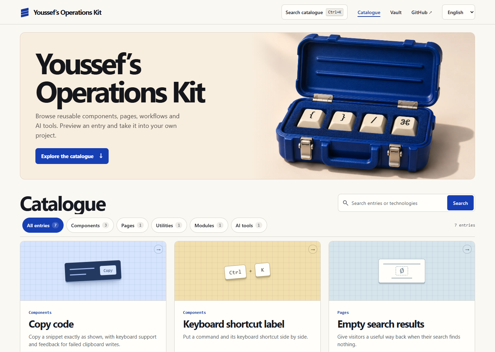

# Kharbout Works

Youssef Kharbout’s engineering workbench brings six interactive system demonstrations, twenty reusable Vault kits, eleven prompt blueprints, five operations templates, four personal prototypes and an International/DACH CV into a static site.

[Logo concept and palette](docs/design/kharbout-works-logo-concept.png)

## Run the workbench

Use Node.js 24 and npm. From the repository root, run:

```sh
npm install
npm run dev
```

Open the [local workbench](http://localhost:4321). Browse the [systems](http://localhost:4321/systems/), [vault](http://localhost:4321/vault/), [AI toolkit](http://localhost:4321/ai-kit/), [templates](http://localhost:4321/templates/), [lab](http://localhost:4321/lab/) and [CV](http://localhost:4321/cv/). Press Ctrl+K or Cmd+K to search. The CV lets you choose a print format and substitute an employer name for the current browser visit.

| Case study | Youssef’s direct ownership | Live demonstrations |
| --- | --- | --- |
| IT Operations & Asset Helpdesk | 100% solo architecture and build. Architecture-verified, held from live fleet rollout. | Service-desk SLA queue and endpoint estate monitor |
| HR Lifecycle Platform | Core contributor and co-architect on the three-developer pre-RMS team | Leave approval desk and attendance month with signed-contract reconstruction |
| Funding, Portfolio & KPI Analytics | Primary architect and full-stack builder of approximately 80% on a three-developer team | Pooled KPI ratios and funding flow with agreement health |

## Claude Code skills

The [Claude Code skills directory](http://localhost:4321/claude-code-skills/) groups guides by task. Search a skill name or alias, open its page and adapt the example prompt. Each guide lists its inputs, usage steps, source and a check for the result. Cowork features and standalone tools identify the environment they require. Prompts carry a **Planned** label until run in their intended assistant. Where a tool was exercised independently on a fixture, **Tool verification** gives the date and observed result. The [guide records](src/data/claude-skills/) also supply the workbench command search.

Filter by agent to see recorded example runs, publisher support, directory listings and reviewed standard-format files. Select **Tested examples only** to see prompts completed in the selected agent. The [UX Copy example](http://localhost:4321/claude-code-skills/design-ux-copy/#example-status) includes the three messages returned by Codex and the kiosk checks they passed. **Guide only** means the agent can load the workbench instructions and the original tool has separate requirements.

Each page offers a Markdown skill file, JSON record and ZIP containing both. Extract the guide folder into the project's `.agents/skills/` for Codex or `.claude/skills/` for Claude Code. The directory also offers a ZIP of every guide. Publisher links lead to the original files, repositories or native setup instructions, including any required tools and companion assets.

The download panel records which agent versions discovered the extracted guide in a fresh project. A discovery label is shown only while its skill name and frontmatter match the [dated discovery records](src/data/claude-skill-discovery.json).

## Prompt Builder

Open the [local Prompt Builder](http://localhost:4321/ai-kit/prompt-builder/) to build a prompt from scratch or start from an everyday or engineering workflow. Edit and export either variant, or save a draft on this device. The [setup and release guide](docs/prompt-builder.md) covers optional sign-in, sharing, AI runs, and staging verification.

## Architecture

Astro builds static routes from four Zod-validated content collections. The service desk and estate monitor hydrate as React 19/TypeScript islands. Alpine 3 handles the HR, funding, toolkit and lab interactions. The six case-study fixtures and three Mermaid diagrams come directly from the master handoff.

Each kit runs inside an isolated preview. Choose a viewport, theme, writing direction, grayscale, or preview implementation. The Alpine and React previews use the same source files shown in their code tabs. The Livewire tab includes PHP and Blade. Shiki highlights the files at build time, and the browser fetches a source tab when it opens. Tailwind 4 and locally bundled Plus Jakarta Sans and JetBrains Mono supply the shared design tokens.

Vault previews on Vercel run in a sandbox. Use the embedded Vault preview to persist demo layout and saved-view preferences.

Ctrl+K searches the generated index in English and Arabic. The matcher normalizes Arabic spelling, tries the other keyboard layout, tolerates small typos and gives recently or frequently selected destinations a higher rank on this device.

The case-study diagrams ship as light and dark SVG assets. After changing a Mermaid source, run `npx playwright install chromium` and `node scripts/render-system-diagrams.mjs` to refresh the assets.

## Vault catalogue

The three extraction lists contain 97 original entries: 44 Project Tracking, 28 IT Helpdesk and 25 pre-RMS HR. The master blueprint curates these into 20 kits and explicitly cites 53 source IDs. Filter by tier, category, source system, keyword or original ID (for example, PT-25). Each kit displays its cited IDs. The provenance badge follows the system evidence in the upgrade blueprint. Each mixed-provenance entry identifies its clean-room addition. Existing preview URLs still open the earlier examples. [Vault source](src/content/vault/) · [Upgrade blueprint](VAULT_MASTER_BLUEPRINT.md)

| Tier | Kits in catalogue order |
| --- | --- |
| T1 · Primitives | 01 Status and urgency vocabulary · 02 Two-band progress and SLA drain · 03 Currency guard and leave balance · 04 Zero-safe queue signals · 05 Withheld pay and attendance day states |
| T2 · Controls and guards | 06 Shared assignee popover · 07 Role-scoped saved views · 08 Guarded edits and confirmations · 09 Failure, retry and formula-safe CSV · 10 Local Office and PDF preview · 11 Fail-closed role drawer |
| T3 · Workflows | 12 Bilingual Ask palette · 13 Lifecycle stepper and status gate · 14 Needs-action digest and versioned inbox · 15 CSV importer and configurable register · 16 Signed terms and dual-line org chart |
| T4 · Flagship engines | 17 Twelve-column desk and row packing · 18 Funding Sankey by currency · 19 Branch endpoint patch panel · 20 Gantt scheduling and month timesheet |

To reuse a kit, open its stack tab and copy each labelled file into the corresponding path. Compile the shared styles with Tailwind v4. For Alpine, register the default model factory as `vaultKit` before starting Alpine. React examples export a component. Livewire examples pair a namespaced PHP class with `resources/views/livewire/<kit-id>.blade.php`. Copy any kit-local app/, resources/ and public/ support files into the corresponding Laravel directories. The Office example ships four downloadable sample files and loads SheetJS and docx-preview on demand. Install the dependency versions recorded in package.json. For its Livewire example, add resources/js/office-preview/register.ts to the application’s Vite entries and copy the model, reader and sample files alongside it. [Design tokens](src/styles/tokens.css) · [Preview styles](src/styles/vault-preview.css)

## How to Replace Starter Assets

| Asset | Edit | What changes |
| --- | --- | --- |
| AI Gems, skills and workflows | [AI kit entries](src/content/ai-kit/) | Keep the frontmatter schema and match each variable key to its Markdown token. Update the starter flag when replacing a blueprint. |
| Architecture and operations templates | [Template entries](src/content/templates/) | Edit the Markdown body, supported formats and optional JSON schema. |
| Lab projects | [Lab metadata](src/data/lab.ts) | Update the summary or supply a screenshot, repository URL or live URL. Each current prototype also has a working demonstration. |
| DACH headshot | `public/photo.jpg` | Drop in a portrait and rebuild. A 96 × 116 monogram appears when a portrait is absent. |
| Career and contact information | [Profile](src/data/profile.ts) | Update the shared availability date, career focus, project highlights, leadership, and contact information. |

## Verify and deploy

```sh
npm ci
npm test
npx astro check
npm run build
npx playwright install chromium
npm run test:workbench
python scripts/audit-public.py
```

The browser suite serves the built `dist/` directory on loopback port 4339. Install Poppler (`pdfinfo` and `pdftotext` on PATH) for the A4 print checks. To exercise an existing local production preview, set `PLAYWRIGHT_WORKBENCH_URL`. Run `npm run preview` to serve the static output yourself.

The Node tests cover the seven shared domain kernels, schedule and timesheet transitions, contrast arithmetic, and a source and public-asset scan. To check private employer or product names, supply one name per line through the optional `VAULT_FORBIDDEN_TERMS` environment variable or GitHub Actions secret. The production audit also checks links and fixture integrity. [Vault upgrade verification](docs/vault-upgrade-verification.md) · [Earlier production checks](docs/production-verification.md)

To run the Livewire examples in isolation, create `test-results/livewire-runtime/`, then run `composer --working-dir=test-results/livewire-runtime require "laravel/framework:13.*" "livewire/livewire:4.*"` and `php tests/workbench/verify-livewire.php`. The check mounts and updates each component against the downloaded framework and checks the examples’ server-side actions. The verifier also builds the Office viewer using the copied files and a real Laravel Vite manifest. Run the following checks for schedule receipts, telemetry freshness and browser interactions against the Livewire client.

~~~sh
php tests/workbench/verify-tier4-contracts.php
npx playwright test --config tests/workbench/livewire.playwright.config.mjs
~~~

Set `PLAYWRIGHT_LIVEWIRE_PORT` to an available loopback port when 4398 is occupied or blocked. Set `PLAYWRIGHT_LIVEWIRE_URL` to use an already prepared local fixture server.

In Vercel, import the GitHub repository with the Astro preset. In Cloudflare Pages, connect the same repository and select the Astro preset. In either provider, use the repository root, Node 24, `npm run build` and output directory `dist`. Set `SITE_URL` to the public origin when a domain is assigned. Source links use `PUBLIC_SOURCE_REF` when set, then the provider’s Git commit SHA, then the public `main` branch. Only portfolio assets are copied into the static export. [Vercel deployment guide](https://docs.astro.build/en/guides/deploy/vercel/) · [Cloudflare Pages deployment guide](https://developers.cloudflare.com/pages/framework-guides/deploy-an-astro-site/)

Domain candidates are `youssefkharbout.dev`, `youss.dev`, `opskit.youss.dev` and `kharbout.dev`.

## Laravel reference catalogue

An open-source catalogue of components, pages, JavaScript utilities, Laravel modules and AI tools. Search by name or technology, filter by collection and open an entry for its preview, source, requirements and a quick verification step. The catalogue supports English, German and Arabic with right-to-left navigation. Reusable source examples retain their original text.

### Open the catalogue



[View the mobile layout](docs/design/catalogue-mobile.png).

From the repository root, with Docker running:

```sh
docker compose up --build -d
```

Open [the local catalogue](http://127.0.0.1:8080). Run `docker compose down` to stop the preview. This configuration serves the local demonstration.

If port 8080 is occupied, set `CATALOGUE_PORT` in your shell before starting Compose. For example, run `$env:CATALOGUE_PORT = '8137'` in PowerShell or `export CATALOGUE_PORT=8137` in a POSIX shell, then open [the alternate port](http://127.0.0.1:8137).

For development, use PHP 8.4 with Phar enabled, Composer 2 and Node.js 24.

```sh
composer install
php -r "file_exists('.env') || copy('.env.example', '.env');"
php artisan key:generate
npm ci
npm run build:catalogue
php artisan serve
```

Open [the development server](http://127.0.0.1:8000). Keep Laravel running and use `npm run dev:catalogue` in a second terminal for frontend hot reload. Generate an application key on initial setup. The catalogue uses file sessions and needs no database or AI-provider account.

### What you can reuse

| Entry | Try it | Take it into your project |
| --- | --- | --- |
| Copy code | Copy a snippet with the keyboard. | React button with independent clipboard feedback and a manual fallback. |
| Keyboard search dialog | Press Ctrl+K or Cmd+K from any catalogue page. Type a term, use the arrow keys and press Enter. | [React dialog and standalone example](kit/components/search-dialog/README.md). |
| Keyboard shortcut label | Compare the shortcut and command at narrow widths. | HTML and CSS for a wrapping command label. |
| Empty search results | Clear an unmatched search and check focus. | [Standalone HTML page](kit/pages/empty-state-page/index.html). |
| Shareable URL filters | Change a search term and inspect the generated URL. | [TypeScript functions](kit/utilities/url-filters/filters.ts) used by Browse. |
| Catalogue search endpoint | Query a small public fixture and inspect the JSON. | [Laravel module](kit/modules/catalogue-search/README.md) with input validation and HTTP tests. |
| Accessible UI review | Compare a review with the worked keyboard example. | [Claude skill and Gemini Gem instructions](kit/ai-tools/accessible-ui-review/README.md). |

Each entry has a **Download source (.zip)** link. Extract the archive and open its README for requirements, setup and a quick check. The archive includes the MIT notice. Individual examples also have a Copy button.

On the home page, use the **AI Skills, Gems & Command Vault** search or press Ctrl+K or Cmd+K to find a workflow by keyword, platform or `#tag`. Open it to fill its prompt variables, compare a simulated before-and-after example and copy the compiled prompt before continuing to your assistant. Add or edit workflows in [the Vault registry](app/Catalogue/WorkflowVault.php). **Example tested** means the built-in example ran in the intended tool or review process.

To try the dialog outside Laravel, download it from its entry into an empty folder and extract it there. From the folder containing the extracted `package.json`, run `npm ci` and `npm run dev`, then open the local URL printed by Vite.

### Follow a request

The [routes](routes/web.php) send page requests to the [catalogue controller](app/Http/Controllers/CatalogueController.php). The [registry](app/Catalogue/EntryCatalogue.php) supplies entry metadata to [Browse](resources/js/pages/Browse.tsx) and [Entry](resources/js/pages/Entry.tsx). Both use the same search matcher. Each published slug has a page and a download route. The download controller builds a ZIP from an explicit list of repository files for that slug.

See the [entry authoring guide](docs/adding-an-entry.md), the [architecture decisions](docs/adr/) and the [security checklist](docs/SECURITY_CHECKLIST.md).

The download route caches ZIPs by the names and contents of their published files. HTTP clients can revalidate a download with its ETag. Catalogue links retain their query and category when the browser loads the HTML fallback.

### Run the catalogue checks

```sh
composer validate --strict
composer audit --locked --no-dev
vendor/bin/pint --test
composer analyse
composer test
npm run lint
npm run format:check
npm run test:kit
npm run build:catalogue
npx playwright install chromium
npm run test:browser
```

ESLint checks the maintained workbench JavaScript, TypeScript, React and Astro source. Prettier also checks changed workbench source and CSS. Published Vault source snapshots keep their original formatting and have separate reuse tests. Local formatting checks compare with HEAD. Set `FORMAT_BASE_REF` to a commit to check a wider change. Run `node scripts/format-workbench-changes.mjs --write` to format those files.

After building both applications, run `npx playwright install chromium firefox webkit` and `npm run test:smoke:browsers`. This runs the same six core flows in all three engines. Use the existing `PLAYWRIGHT_WORKBENCH_URL` and `PLAYWRIGHT_BASE_URL` overrides to test local servers already running.

Playwright starts Laravel on port 8029 and uses the built assets. To test a running native or Docker preview, set `PLAYWRIGHT_BASE_URL` to its local URL. On Linux CI, install the browser with `npx playwright install --with-deps chromium`. To use an existing Chromium executable locally, set `PLAYWRIGHT_CHROMIUM_EXECUTABLE` to its path.

## Roadmap

Start by reusing one entry in another project and recording any missing dependency or unclear instruction as an issue. Add subsequent entries when they solve a specific task, have a runnable example and pass their verification steps. A tagged release follows maintainer review of the candidate and green CI.

[Contributing](CONTRIBUTING.md) · [Changelog](CHANGELOG.md) · [MIT license](LICENSE)
