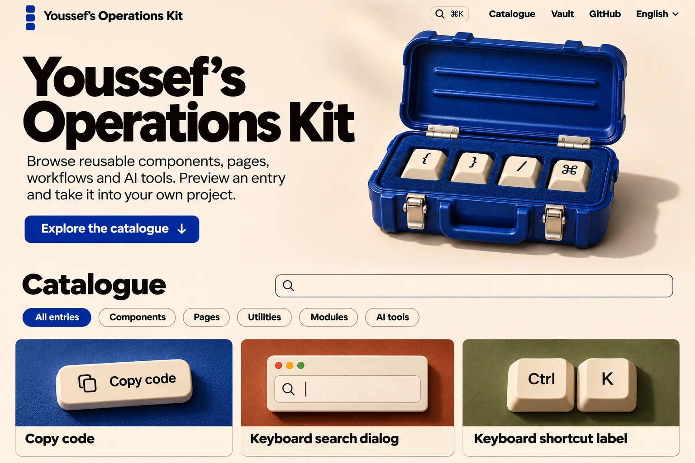

# Catalogue design

## The working parts catalogue

The open case on the cover introduces the idea behind the kit. Each object inside has a purpose and can be taken into another project. The catalogue carries that idea into its cards. A visitor can recognize a shortcut, search field or code snippet from its sample, read the requirements and open the preview or title. The darker Vault groups editable prompts by platform and shows the variable each workflow expects.

Refero’s Styles gallery keeps search in view while the tiles scroll beneath it. Its topic shelf moves horizontally, and hovering a tile lifts the screenshot inside its frame as a tinted layer fades in. The kit applies these ideas to the catalogue and the Vault. [Refero Styles](https://refero.design/styles)

The filter row pins while its section is in view and releases at the section boundary. On phones the filters swipe sideways, and tabbing brings the focused filter into view. Short windows give the full height to the results. Previews settle into place as they enter the viewport, then lift inside the card on pointer hover or keyboard focus. Titles and click targets stay in place. Search, drawer and tab transitions share a short fade. Reduced-motion settings preserve the focus and selection cues with still artwork and immediate panel changes.

Compare the [desktop implementation](catalogue-desktop.png) and the [phone implementation](catalogue-mobile.png) with the concept above.

[Watch the six-second walkthrough](catalogue-motion.webp) to see the filter row pin, the card preview lift and the Vault drawer open.

Art direction and prompts

The desktop cover uses the [full-size case image](../../resources/images/operations-case.webp). The phone layout loads a [smaller export](../../resources/images/operations-case-small.webp).

**Case photograph**

> Photograph for a developer's parts catalogue. An open cobalt-blue molded portable equipment case, seen from slightly above in a three-quarter view, hinges and latches in brushed silver, with machined ivory keyboard keys marked with the simple symbols { }, /, and ⌘ nested in fitted deep-blue foam. The inside lid has three shallow blue molded ribs. Case fills a centered horizontal frame with breathing room all around, including its soft shadow. Warm off-white seamless studio ground and background, directional afternoon light from the upper left, crisp tactile surfaces. A single object, strong silhouette, restrained industrial product photography. No titles, typography elsewhere, logos, people or watermark.

**Desktop concept using the case as a reference**

> Create a crisp high-fidelity DESKTOP website design concept for 'Youssef’s Operations Kit', a real open-source catalogue. Landscape 3:2 artboard, full edge-to-edge website screenshot, no browser frame. Use the attached photograph exactly as the product artwork in the right half of an elegant wide hero spread. A warm ivory paper page, ink black typography, small cobalt identity made of 3 stacked tiles. Compact left-aligned brand and right aligned search shortcut, Catalogue, Vault, GitHub, English navigation. Large left hero headline in expressive near-black tightly tracked grotesque type with first line 'Youssef’s' and second line 'Operations Kit'. Under it: 'Browse reusable components, pages, workflows and AI tools. Preview an entry and take it into your own project.' Cobalt primary button 'Explore the catalogue' with a down arrow. Photo in a generous right half with a warm studio backdrop. Under a modest breathing space show 'Catalogue' as a strong section heading, an aligned search field, filter chips 'All entries', 'Components', 'Pages', 'Utilities', 'Modules', 'AI tools' and three cards entitled 'Copy code', 'Keyboard search dialog', 'Keyboard shortcut label'. The card previews are beautiful editorial still lifes of UI objects (a copy code button, little search window, ivory Ctrl and K keys) on distinct tinted grounds. Strong reading order, enormous care in hierarchy and space, visitors can see some cards in first viewport. Use only the necessary words supplied. This is an interface concept in the style of an expertly art-directed printed tool catalogue, no filler labels or badges, no phones or other objects around the page. Output website image only.

**Question for design review:** Can a visitor tell what they can take, whether it fits their stack and where to start adapting it?

## Two layouts

**Browse.** Make the catalogue the front door. Lead with the kit's name and a one-line description. Group entries by the thing a visitor wants to take away. A result shows its name, a concrete use and its dependencies. Give each published entry a stable link so people can share it directly.

**Entry.** Show the outcome first, then a preview or worked example. Put the minimum requirements beside it. Follow with setup or usage, the parts someone is likely to change, and a quick way to verify the result. Link directly to the relevant source files when a real entry ships.

| Category | What a visitor takes away | What serves as its preview |
| --- | --- | --- |
| Components | An interface element | Rendered states and keyboard behaviour |
| Pages | A complete screen layout | Desktop and mobile examples |
| Utilities | A focused JavaScript or TypeScript function | A concrete input and its output |
| Modules | A workflow with connected parts | A short scenario and a link to its implementation |
| AI tools | A Claude skill, Gemini Gem guide or project instructions | A sample task, required tools and expected result |

## Rules for the first build

- Start with one browse layout and one entry layout. Open only categories with published entries in the live catalogue. The design mockup can show illustrative content.
- Use technology names as metadata. A TypeScript utility should be discoverable even if the visitor has never used Laravel. A Gemini guide needs to identify its target tool just as clearly as a component identifies its framework.
- Keep explanatory text next to the element it describes. On a phone the preview, requirements and instructions should read in that order. Allow labels to wrap. Use logical spacing and alignment so the layout can support Arabic.
- Source belongs with the entry that uses it. When the first feature arrives, add the files, a working example and its verification steps together. Introduce a shared abstraction when a second entry demonstrates what the two actually share.

The [original static concept](catalogue.html) records the first browse and entry layouts.
